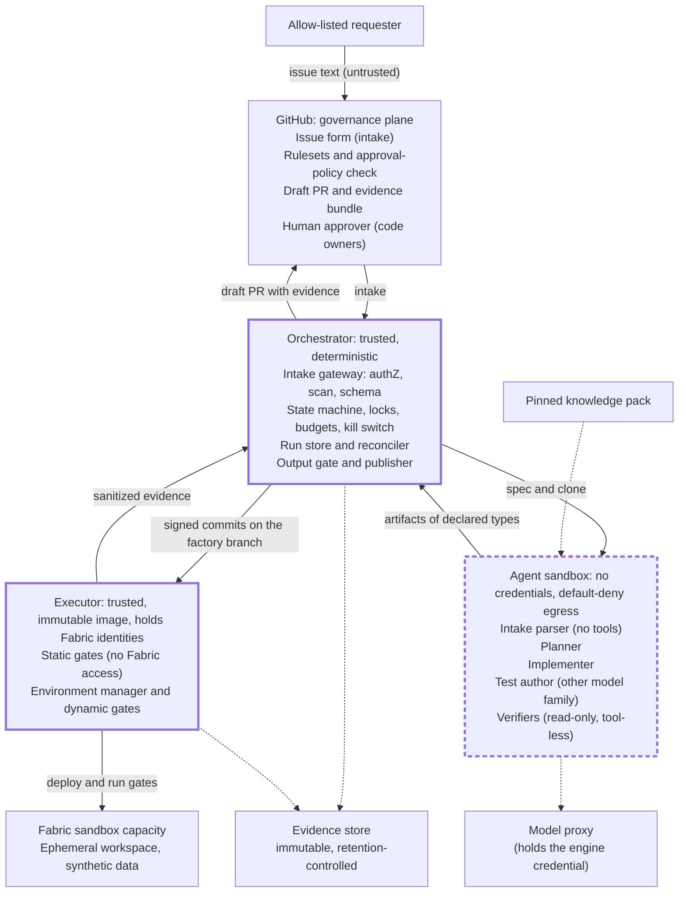
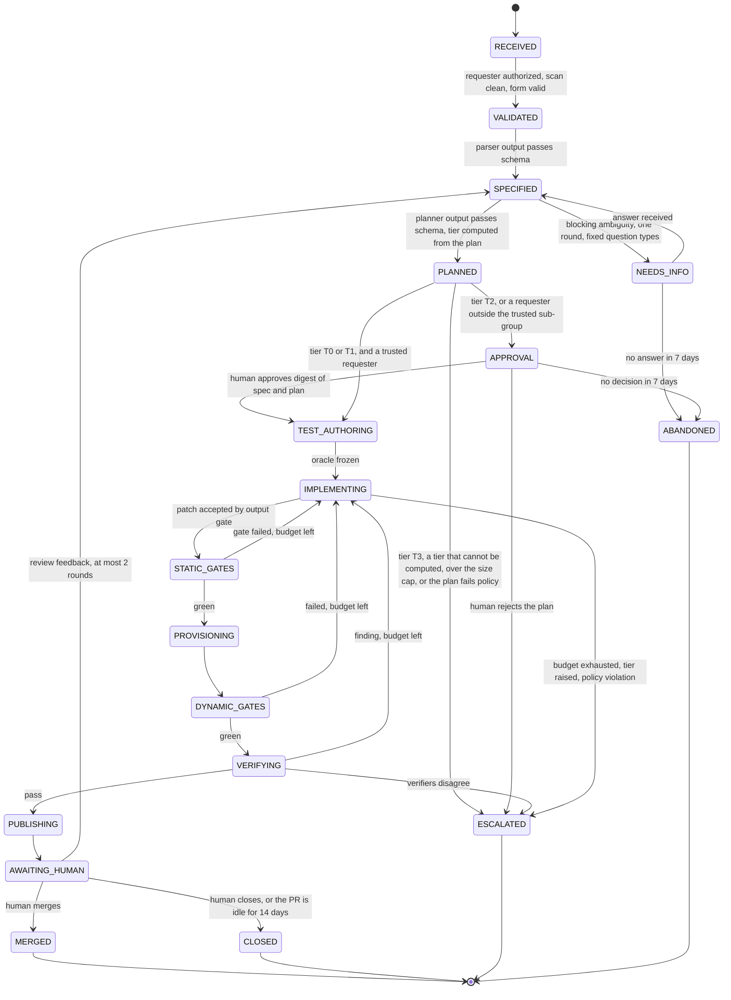

# Fabric Code Factory — Design

Version 0.2 · 2026-10-30 · Status: revised after the three-model review (70 findings, all dispositioned in `reviews/disposition-log.md`), then closure-checked by the same three reviewers (`reviews/closure-gemini.md`, `reviews/closure-gpt.md`, `reviews/closure-grok.md`). The closure check raised 11 new problems and four partly-closed findings. All are folded in below, and all three reviewers said the design is good enough to start the Phase 0 spikes. "Closed" means closed on paper: the spikes still have to prove the platform assumptions. v0.1 is in `archive/04-design-v0.1.md`. After publication, six verification rounds (a clean-room CI run, checks of the platform facts against primary sources, three-model passes with rotated roles, and three closure checks of what the round before had changed) corrected further points, which are listed in `reviews/round-1-findings.md`, `reviews/round-2-findings.md`, `reviews/round-3-findings.md`, `reviews/round-4-findings.md`, `reviews/round-5-findings.md` and `reviews/round-6-findings.md`. This is a design: nothing in it has been built or tested on a tenant.

Inputs: requirements v0.3 (`01-requirements.md`), decision register v0.2 (`02-decision-register.md`), landscape digest (`03-landscape-research.md`), raw reports T1 to T7 and O1 (`research/raw/`), cross-verification (`reviews/xv-results.md`), the four review registers (`reviews/`).

Reference keys: FR-nn and NFR-nn are in the requirements. D-nn are in the decision register. **K1 to K12** are the components (v0.1 called them C1 to C11, which collided with the controls). **C1 to C15** are the minimum security controls and **G1 to G16** the quality gates, both in the landscape digest. **S1 to S11** are the Phase 0 spikes. **PS-1 to PS-6** are the pilot success criteria. **HR-n** are the hard rules. **T0 to T3** are the risk tiers.

## 1. Summary

The factory turns a GitHub issue into a verified draft pull request against Git-backed Fabric item definitions, then stops and waits for a human.

1. **Git is the source of truth and the human control plane.** Fabric workspaces are downstream of Git.
2. **Agents propose, a deterministic executor disposes.** Agents see a repo clone and sanitized evidence. No credential of any kind is reachable from the agent job. The executor takes a run ID and a step, never an agent-chosen argument, and applies only a validated deployment manifest.
3. **A run store is the system of record.** Every stage is idempotent, intent-logged, budgeted and cancellable. A reconciler resumes stale runs, and an ambiguous outcome after a lost response is settled by asking the provider.
4. **Doer is not judge.** A separate test author writes declarative oracle tests. Spec, fixtures and oracle are frozen against the implementer. Verifiers from other model families advise. Deterministic gates decide.
5. **Validation happens in an ephemeral sandbox workspace** on a dedicated capacity with synthetic data, built in order (seed, SQL endpoint, then models and reports) and torn down by permanent deletion.
6. **The factory never merges, approves or promotes.** A required check enforces that the approver is not the requester, within a window that 3.6 bounds. Deployment to dev after a merge is a human step in v1.
7. **Knowledge is pinned.** Official Fabric skills plus a factory plugin, scanned and evaluated against a golden suite before every change.
8. **Work is sized to about one human-hour,** counted in semantic units. Larger requests are split by a human or escalated. Security-sensitive changes are out of autonomous scope in v1.
9. **Pilot slice, in two stages.** Stage 1: semantic models and reports, tiers T0 and T1. Stage 2: data agents and ontology, with T2.
10. **Prove, then build.** Eleven Phase 0 spikes test the platform and the controls. No live issue is processed until isolation (S7), identity (S2), repository controls (S11) and recovery (S5) have passed.

"Silent" means no human interaction while a run executes. People are told when a PR is ready or when the run escalates.

**What changed since v0.1.** The panel found that v0.1 had the right shape but several controls were bypassable as written. The main changes: the executor no longer takes agent-chosen arguments (HR-2), no model or Git token reaches the agent job (HR-3), a run store replaces the Git ledger as the system of record (3.3), the Git controls are a concrete matrix with negative tests (3.6), the sandbox is built in an order that works and is torn down by permanent deletion (3.7), variable libraries are no longer used to bind models (3.7), the policy engine parses item definitions instead of matching paths (3.9), and the controls that v0.1 deferred to Phase 2 now gate Phase 1 (4.2).

## 2. Hard rules

Every component obeys these. A design change that breaks one needs a decision record.

| ID | Rule |
|---|---|
| HR-1 | Git is the source of truth. One writer per branch. `factory/*` branches are written only by the publisher. Factory-managed workspaces are downstream-only: nobody commits from them. |
| HR-2 | Agents propose, the executor disposes. Agent output is declarative (a patch, a spec, a verdict). Only trusted code applies it. **The executor takes a run ID and a step. The orchestrator chooses the suite, fixtures, parameter file and target workspace GUID from the pinned policy and the run store. Nothing in a branch names a target.** |
| HR-3 | **No credential is reachable from the agent job:** no repository-push, Fabric, billing, model or Git token, in its environment, files or process tree. Model access goes through a proxy outside that tree. This is proven by test (S7), not asserted. |
| HR-4 | Intake text is data, never instructions. It cannot widen permissions, change policy, choose credentials, or name a target outside the allow-list. |
| HR-5 | The implementer never writes the spec, fixtures, generators or oracle tests that judge its change, and never sees the hidden checks. These are frozen once the spec is approved. |
| HR-6 | Deterministic gates decide. AI reviewers advise and can only add blocks, never remove them. |
| HR-7 | Every stage is idempotent, intent-logged, checkpointed, budgeted and cancellable. Retries are bounded. Budgets are atomic counters. |
| HR-8 | In v1 the factory never merges, approves, promotes, deletes outside its own sandbox, or touches permissions, RLS or OLS, connections, sensitivity labels, schedules, or tenant or capacity settings (risk tier T3). The policy engine parses item definitions to enforce this. A path allow-list alone is not enough. |
| HR-9 | Everything the factory loads (skills, templates, MCP servers, CLIs, Actions, images, gates, policies) is pinned by version, SHA or digest, scanned, and versioned. No run-time installs from the open internet. The executor image is immutable and runs no repository scripts. |
| HR-10 | Evidence over narration. The PR's evidence is generated from run artifacts, kept in retention-controlled storage, and never taken from a file an agent can edit. |
| HR-11 | A gate is never weakened to get a pass. Tests are protected from the implementer. A test expectation changes only through an approved criterion (an oracle migration), never through the implementer's edit. |
| HR-12 | **Fail closed.** A schema error, an unknown field, a timeout, a missing control or a failed preflight is a stop, never a pass. |

## 3. Architecture

### 3.1 Zones, trust boundaries and process isolation

Thick solid border: trusted code. Thick dashed border: the confined agent sandbox. Dotted arrows: supporting access (the pinned knowledge pack in, model calls out through the proxy, evidence writes). The sandbox has no direct path to the executor or to Fabric: its artifacts reach them only through the orchestrator's output gate.

Trust boundaries that matter:

- **GitHub to orchestrator.** Issue text is untrusted. Only an allow-listed requester can start a run. The target alias comes from a server-side allow-list, the branch slug allows `[a-z0-9-]` only, no issue field reaches a shell, and no job that holds a secret fetches a link from the issue.
- **Orchestrator to sandbox.** The sandbox receives a spec and a clone, and returns artifacts of declared types (patch, spec, verdict). It has no credentials and default-deny egress. A separate trusted job validates and externalizes the artifacts. Nothing the agent writes is executed by a credentialed process.
- **Sandbox to executor.** The executor accepts a run ID and a step. It reads the target GUID, suite, fixtures and parameter file from the run store and the pinned policy. It never runs agent-supplied commands or scripts, and it deploys only a validated manifest (3.9).
- **Executor to Fabric.** Only workspaces on the sandbox capacity that the executor created, matched by GUID against the registry in the run store. Agent-authored code (notebooks, pipelines) can run there, under a separate low-privilege identity (3.5).

**What S7 must prove.** The Copilot cloud agent's own firewall covers only processes started through its shell tool, and GitHub-hosted runners have open egress by default, so isolation is a property to demonstrate. The preferred D0 substrate is **gh-aw in strict mode**. Its architecture has the same shape as ours: a network firewall, an API proxy that routes model traffic and may hold the engine credential, an MCP gateway that spawns isolated MCP-server containers, and a buffering stage (SafeOutputs) that externalizes agent writes only after deterministic filters. Its documentation also warns that setup, post, detection and safe-output steps are trusted code that is not confined, that a read-only `GITHUB_TOKEN` does not remove other credentials, and that threat detection defaults to warn. Its defaults are also wider than ours: with no `network:` setting it allows basic infrastructure domains and common package mirrors (only `network: {}` blocks all access), it allows GitHub's own domains by default, it auto-enables the `create-issue` safe output when no other is configured, and `merge-pull-request` and `push-to-pull-request-branch` exist as safe-output types. The factory's workflow therefore pins `network: {}` and a minimal safe-output set explicitly (I-8). The tests:

| # | Property | Test |
|---|---|---|
| I-1 | No credential readable | From inside the agent container: the environment, the filesystem, sibling process data and runner files hold no model, GitHub, Azure or Fabric token. The job token has read-only permissions, plus `copilot-requests: write` if the Copilot engine needs it, and no ID token |
| I-2 | Egress deny for every confined process | Canary connections to a controlled endpoint from the agent, from a child process and from an MCP server all fail. Allowed destinations: the model proxy and, at build time only, a hash-pinned package mirror. Setup, pre-activation, post and detection steps are not confined by the firewall, so they are treated as trusted code: pinned by SHA, reviewed, and with no network calls of their own. GitHub's own domains are allowed by default, so with no GitHub credential in the job they leave unauthenticated reads only, and the canary shows that |
| I-3 | Model mediation | Model requests pass through a proxy that holds the engine credential. The agent cannot read it, cannot call the model service directly, and can use only the allow-listed models. The proxy is not a caller-authentication boundary, so code running in the container can still use it for inference. That exposure is inference spend. In D0 it is bounded by the gh-aw limits set in the workflow (`max-ai-credits`, `max-turns`) and the organisation budget, and S9 measures how far spend can exceed them (3.14). The requests carry nothing the agent does not already hold |
| I-4 | Filesystem scope | The agent sees the clone of the test-merge tree, the pinned knowledge pack (read-only) and a scratch directory. No runner tooling and no other run's data are mounted |
| I-5 | Output typing | The job emits only artifacts of declared types. Anything else is dropped and logged |
| I-6 | Tool restriction | The Power BI Authoring MCP runs only with `--readonly` and the EULA flag, and with no Fabric credentials. Other MCP servers are offline documentation tools. A per-role tool allow-list applies |
| I-7 | Supply chain | Actions are pinned by SHA. The agent and executor images are pinned by digest. There is no package network at run time. Skill text cannot authorize an install |
| I-8 | Declared capabilities | The compiled workflow is checked in CI against a pinned set. `network` is `{}` or an explicit minimal list, never the default set. Safe outputs are limited to the declared artifact types: no `merge-pull-request`, no `push-to-pull-request-branch`, and `create-issue` explicitly disabled. S7 fails if the compiled workflow grants more |

**Fallback ladder** if I-1 to I-3 or I-8 cannot be shown: (1) gh-aw strict on a hosted runner with the microVM option, (2) an ephemeral self-hosted runner behind an egress proxy with a credential broker, (3) a container worker with a gateway-issued, budget-capped, per-run token (the D1 path, brought forward). If none passes, Phase 1 does not start on live issues.

**GitHub Environments.** Executor and publisher jobs run from `main` of a protected control repository and check the factory branch out as data, never as workflow code. The `sandbox` Environment has no required reviewers, because a pause for a human click would break "silent", and its deployment branches are limited to `main` of the control repository. Its protection comes from the rulesets, the federated-credential subject, and the preflight. Any Environment that does require reviewers is asserted by the preflight, because a missing reviewer list would silently remove the pause (HR-12).

### 3.2 Components

Components are K1 to K12. v0.1 numbering is in brackets.

| ID | Component | Responsibility | Trust | First implementation (D0) | Durable implementation (D1) |
|---|---|---|---|---|---|
| K1 [C1] | Intake gateway | Authenticate the requester, run the pre-model secret and PII scan, validate the form, write the run record, label the issue | Trusted | Actions workflow on issue events, allow-list check, data-only handling of issue text | Same, plus a webhook to the orchestrator |
| K2 [C2] | Orchestrator | State machine, dispatch of stage jobs, kill switch, budgets | Trusted | Actions workflows from the control repo. Stage jobs are dispatched with a run ID and a stage name only | Durable Task Scheduler orchestrations and activities |
| K3 [new] | Run store and reconciler | System of record: runs, operations (intents), item locks, leases, budget counters, the workspace registry. A scheduled reconciler resumes stale runs and finalizes dead ones | Trusted | Azure Table Storage with Entra authentication. Scheduled workflow every few minutes | Same store, reconciler as an orchestration |
| K4 [C3] | Agent runtime | Run role sessions in the sandbox | Untrusted | gh-aw (strict) agent jobs, ephemeral, no credentials | Container jobs with the Copilot SDK in server mode, our own pinned image |
| K5 [C4] | Output gate and publisher | Parse-validate each patch, push signed commits, open and update the PR, post required checks | Trusted | Separate job in a protected Environment, GitHub App token | Activity with its own identity |
| K6 [C5] | Static gate runner | G1 to G3, G10, secret scan, integrity guard. Treats agent files as data and never executes them | Trusted | Job without Fabric credentials | Activity |
| K7 [C6] | Executor | Typed operations against the sandbox. Takes a run ID and a step | Trusted | Job bound to the `sandbox` Environment, authenticated by OIDC, immutable image | Activities on container apps with a managed identity |
| K8 [C7] | Verifier panel | Independent, read-only reviews | Outputs untrusted | Agent jobs calling other model families | Same, through the gateway |
| K9 [C8] | Knowledge pack loader | Fetch the pinned bundle, verify digests, scan it | Trusted | Step in the image build | Image build |
| K10 [C9] | Evaluation harness | Golden set, red-team set, regression, shadow, canary, drift probes | Trusted | Scheduled workflows in a separate repo | Same |
| K11 [C10] | Audit and telemetry | Evidence store, traces, dashboards, detections | Trusted | An immutable blob container with a time-based retention policy, plus the run store. Attestations for provenance | Same, plus Log Analytics |
| K12 [C11] | Policy as code | Allow and deny lists, tier rules, parse rules, thresholds, budgets, fixture profiles | Trusted | Protected repo, two approvers | Same |

The same state machine and run-store schema run in both columns. Moving from D0 to D1 replaces the runtime, not the design. If S5 shows that resuming Actions workflows is too brittle, D1's Durable Task Scheduler is brought forward and the store stays.

**Run-store layout (Azure Table Storage).** `Runs` (state, epoch, lease owner and expiry, tier, spec and plan digests, base and candidate SHAs). `Operations` (one row per side-effecting call: intent, idempotency key, provider object ID, result digest, status). `Locks` (the partition key is the target alias and each row is one item path, taken in one atomic batch of at most 100 rows, so a run holds all of its item locks or none. A plan with more than 100 item paths is refused at admission, which the size cap makes a non-event). `Budgets` (the per-run and the daily counter live in one partition, so a reservation updates both in one batch with ETag conditions). `Registry` (append-only: every workspace GUID and every item GUID the executor created, which teardown needs, because Fabric documents no endpoint that lists soft-deleted items). Table Storage makes a batch atomic only within one table and one partition, and caps it at 100 entities and 4 MiB, so nothing is assumed atomic across tables: the intent-first protocol (3.3) covers that. Keys cannot contain `/`, `\`, `#` or `?`, so item paths are encoded. The Git ledger is an optional projection (Phase 1 may omit it, since the evidence container is the audit record). If kept, it is written to a per-run branch `factory-ledger/<run-id>`, which rulesets RS-C1 and RS-C2 protect (3.6): one writer, no force-push.

### 3.3 Run lifecycle, state and recovery

The three exits from PLANNED are tried in the order drawn and the first that matches wins, so a run takes exactly one of them. A T3 or oversize plan never reaches approval, and an untrusted requester never reaches TEST_AUTHORING without the approval. The diagram does not draw CANCELLED, the fifth terminal state, because every state that is not terminal can reach it (see the rules below).

A run ends in exactly one terminal state:

| Terminal state | Entered when | Left behind | Locks, workspace and reconciler |
|---|---|---|---|
| MERGED | A human merges the PR | The merged PR | Locks released at the merge. The workspace expires by lifetime 3 below |
| CLOSED | A human closes the PR, or it is idle for 14 days | The closed PR | Locks released at the close. The workspace expires by lifetime 3 |
| ESCALATED | Budget exhausted, tier raised, policy violation, T3 or oversize plan, failed preflight, a rejected plan, disagreeing verifiers, the run deadline, or an infrastructure failure after the retries | A failure report as a comment. A draft PR only when part of the work passed its gates | Locks are released at once when there is no PR. A draft PR keeps them until it is closed, which lifetime 4 bounds at 14 idle days. The workspace expires by lifetime 3 |
| CANCELLED | The kill switch or a `factory:cancel` label, from any state that is not terminal | A comment that says who cancelled and when. If a PR is open, its evidence is voided and it is converted to a draft as a signal to people (see the rules below) | Active provider operations that have a cancel call are cancelled by type, the locks are released, and the workspace is torn down at once, or by the sweeper under lifetime 3 if the executor cannot run |
| ABANDONED | No answer to the one clarification round, or no decision on the spec approval, within 7 days | A comment on the issue | The locks, if they were taken, are released. No workspace exists yet |

A run ends in exactly one terminal state because terminal transitions are compare-and-swap on the run record: the first one wins, and a later one is recorded as an event, never as a second state. The reconciler treats a terminal run as finished and only sweeps what a finalizer left behind.

Rules that the diagram does not show:

- **Any state that is not terminal can end in CANCELLED** through the kill switch (3.16). A working state is any state that is not terminal and not a wait for a human. From a working state, budget exhaustion, a raised tier, a policy violation, a failed preflight or an infrastructure failure after the retries ends in ESCALATED with a flag that says which. The diagram draws only the most common of these edges.
- **Waiting for a human is not a stalled run.** NEEDS_INFO, APPROVAL and AWAITING_HUMAN hold no lease and are never re-dispatched or escalated by the reconciler's stage timeout. Each has its own deadline: 7 days for NEEDS_INFO and APPROVAL, which end ABANDONED, and 14 idle days for AWAITING_HUMAN, which ends CLOSED. The reconciler only checks that those deadlines are enforced. The run deadline below counts time in working states only, and stops while the run waits for a human.
- **An open PR is not left mergeable while the run works.** When a run leaves AWAITING_HUMAN for anything but MERGED or CLOSED (review feedback sends it back to SPECIFIED, and a later revision can end in ESCALATED or CANCELLED), the publisher fails `factory/evidence` on the current head, so that the earlier green head cannot be merged in the middle of a revision, and it converts the PR back to a draft. The failed check is the control. It is posted with the conclusion `failure`, because GitHub counts `success`, `skipped` and `neutral` as passing, and it is posted on the head commit, because a check on an earlier commit does not count. The draft is only a signal to people: a draft cannot be merged until it is marked ready, but anyone with write access can mark it ready, so no rule rests on it. The body parameters that the REST reference documents for updating a PR do not include a draft flag, and the GraphQL API has mutations that convert a PR to a draft and mark it ready, so the publisher uses those, and the permission the conversion needs is not documented (S11 tests it, and the control does not depend on it). A new green candidate posts a passing check and marks the PR ready again.
- **Plan before approval, tier from the diff.** The tier is first computed from the plan, then recomputed from the actual semantic diff at every iteration and at publishing. A raise voids the earlier approval and ends the run in ESCALATED. An approval covers one digest of spec and plan.
- **Feedback re-enters through the spec.** A comment from an authenticated code owner restarts at SPECIFIED, so scope, tier, approval and the frozen oracle are re-evaluated. Comments are scanned before they enter a spec. At most 2 rounds.
- **Authoritative state and fencing.** The run store is the system of record. A worker takes a lease by compare-and-swap, which increments the epoch. Every write carries the epoch, and a write from a stale epoch is rejected.
- **Handover and the stale worker.** An ETag fences writes to the run store, not calls to Fabric, so a worker that is presumed dead (a hung job, a partitioned runner) could still call Fabric after another worker has taken the lease. Before the reconciler takes a lease over, it cancels the old worker's workflow run through the Actions API and waits until that run has ended. Every executor call also re-reads the epoch immediately before it acts and stops if the epoch has moved. A check cannot close the window for a call already in flight, so the exposure is bounded as well: a call can reach only a workspace in the registry, a late write from the old epoch to the store is rejected, and if the old run cannot be confirmed ended, its environment is not adopted but rebuilt in a new workspace while the old one goes to teardown.
- **Operation intents.** Before any side effect the executor writes an intent (operation, input digest, idempotency key, the tag the provider object will carry). After the call it records the provider's object ID and the result. Fabric calls are not idempotent by themselves (the job-submission call returns a server-generated instance with no client deduplication key), so on resume every intent without a result is reconciled by asking the provider: list workspaces by the run tag on the sandbox capacity, list job instances of the item. Outcomes: adopt (exactly one match), retry (none, and the operation is safe to repeat), rebuild (the environment is disposable, so delete and recreate it), or quarantine and alert (the outcome cannot be decided). The publisher's GitHub side effects follow the same rule: a commit carries the `Factory-Run` and `Factory-Iteration` trailers and is made against an expected head, so a retry cannot add it twice, and on resume a PR is looked up by its head branch, a check run by its name and head SHA, and a comment by a hidden run marker in its body, and the retry adopts what it finds.
- **Reconciler and watchdog.** A scheduled workflow reads the run store, finds runs in a working state (not waiting for a human) whose lease has expired or whose last event is older than the stage timeout, and re-dispatches from the last completed stage, at most 3 times, then ESCALATED. Each run also has a deadline, counted in working states only. Reaching it cancels the active provider operations that have a cancel call (job instances and enhanced refreshes), lets an export drain because Power BI documents no way to cancel one, runs the finalizers, quarantines anything that cannot be cancelled with the residual exposure recorded, and ends the run in ESCALATED with a deadline flag.
- **Four lifetimes, never conflated.** (1) *Compute lease*: the capacity is resumed while a reference count is above zero and paused after an idle window (default 15 minutes). (2) *Item reservation*: the locks on the run's item paths, each carrying the run ID and, once the PR is opened, the PR number, held from PLANNED until the PR is merged or closed (a PR closes after 14 idle days) or, when the run ends without a PR, released at once. A revision that adds item paths takes the extra locks in one batch and escalates instead of waiting if any is held, so it cannot deadlock. A lock whose run is terminal and whose PR is closed is releasable by the reconciler. (3) *Workspace expiry*: the sandbox workspace is torn down 24 hours after its last dynamic gate, or 24 hours after it was created if no gate ran. (4) *PR*: open until a human decides, or closed after 14 idle days. The end of a workspace never closes a PR, and a human who wants to look at an expired result asks for a preview (3.7).
- **Budgets per unit (defaults to calibrate).** At most 6 implement-and-static-gate iterations and 3 dynamic cycles, a wall-clock cap, and token and dollar caps held as atomic counters in the run store: reserve a worst-case cost before dispatch, reconcile after (3.14). The same failure signature twice forces one plan revision, then an escalation.
- **Preflight and fail-closed.** Before each run, and again before PROVISIONING, a conformance check asserts: the four rulesets (RS-A, RS-B, RS-C1, RS-C2) and the App-pinned required checks (read back through the API), the `sandbox` Environment configuration, the identities' role assignments (the deployer has no role on dev, test or production, and each runner holds a grant only on its leased workspace), the target capacity ID, the kill-switch state, the digest of the policy pin, the federated credentials' subjects against the repository's current subject format, the publisher App's Members permission and its subscription to the review, pull-request, membership and team events, the age of the last approval sweep (3.6), and the result of the latest egress canary. Any deviation ends the run in ESCALATED (preflight), and the run never falls back to another capacity.
- **Test-merge tree.** Static and dynamic gates run on the candidate merged into current `main`. The evidence names both the base and the candidate SHA. If `main` moves before a human decides, the evidence is void, the `factory/evidence` check fails, and the reconciler re-validates a bounded number of times.
- **Outcome labels.** Reports and metrics use labels that map onto the states above. DONE is a PR open for review (AWAITING_HUMAN, which is not terminal). PARTIAL is ESCALATED with a draft PR. BLOCKED is ESCALATED with a comment and no PR. MERGED, CLOSED, CANCELLED and ABANDONED are reported under their own names. PARTIAL, BLOCKED and ABANDONED each leave a draft PR or a comment with a failure report. A report for a policy violation carries the rejection reason and never the rejected patch. Partial work is never merged.
- **Escalate is always available to the implementer.** Offering an explicit "I cannot do this, ask a human" action reduced test cheating in the ImpossibleBench study.

### 3.4 Roles and models

Model per role is configuration, not code. Defaults follow the operating model: Sonnet 5.5 leads, and GPT 6.1 Sol, Gemini 4 Argon and Grok 4.7 judge.

| Role | Purpose | Default model | Tools | Sees | Cannot |
|---|---|---|---|---|---|
| Intake parser | Turn the issue into a schema-valid spec | Sonnet 5.5 | None | Scanned issue text, form fields | Use tools, see secrets, see the repo |
| Planner | Items to change, order, impact analysis, test plan, rollback plan, size, estimated cost, tier | Sonnet 5.5 | Read-only repo, offline Fabric docs | Spec, clone | Write |
| Test author | Declarative oracle tests from the spec, before implementation | GPT 6.1 Sol | Read-only repo, offline Fabric docs | Spec, schema, fixture profile and reference values | See the implementation |
| Implementer | Change item definitions inside a bounded loop | Sonnet 5.5 | Write to its clone, run the static gates locally | Spec, plan, visible oracle tests, category-only failure evidence | Push, call Fabric, edit protected or frozen paths, see hidden checks |
| Verifiers | Judge the diff against the spec and the evidence | GPT 6.1 Sol, Gemini 4 Argon, Grok 4.7 (a family other than the implementer's) | None | Spec, plan, diff, sanitized evidence | Use tools, modify anything |

Notes:

- The DAX LLM Benchmark v2 (2026-10-27; 94 single-shot tasks, DAX writing only) scores Sonnet 5.5 lowest of the four at single-shot DAX writing (84.6% against 87.5% to 91.4%). Gates make this tolerable, and the golden suite decides whether a DAX-heavy pack should route drafting to another model.
- Verifier verdicts are advisory (HR-6). The schema is strict: per-criterion verdict, risk findings, integrity concerns, a "not verified" list, confidence. Trusted code joins verdicts to the spec's criterion IDs and ignores any other field. Free text never flows to the next stage.
- Verifiers are tool-less and read-only. This follows the independent-critic pattern, with the fail-safe that no patch is applied.

### 3.5 Identities and secrets

| Identity | Type | Rights | Never |
|---|---|---|---|
| Requester | Human (GitHub) | File an issue, cancel own run | Approve own PR (enforced by the approval-policy check, 3.6) |
| Approver | Human, code-owners team | Approve and merge (the only bypass on ruleset RS-A) | Be the requester |
| `factory-intake` | GitHub App | Read issues, comment, label | Contents write |
| `factory-publisher` | GitHub App | Contents write on `factory/*` and `factory-ledger/*` only (writer ruleset RS-C1, and RS-C2 binds it too), pull-request, checks and commit statuses write, and organisation Members read, which the membership and team events need. It is subscribed to the review, pull-request, membership (a member added to or removed from a team) and team (a team edited, or its access to the repository changed) events. Creates commits through the GraphQL `createCommitOnBranch` mutation. GitHub documents that the commit is authored by the owner of the credential (the App), that the mutation cannot set the author or committer, and that it is signed "if supported", so whether these commits show as verified is not assumed: S11 tests it. Another route (the Contents or Git Data API) is used only if S11 shows its commits verify | Be in any bypass list for `main`, approve, merge (negative-tested in S11) |
| Agent sandbox | None | Proxied model calls | Hold or reach any credential |
| `fcf-state` | Entra identity, OIDC | Table data write on the run store. Blob write, no delete, on the evidence container | Any Fabric role |
| `fcf-deployer` | Entra service principal or managed identity, OIDC federated to the `sandbox` Environment | Create and delete workspaces on the sandbox capacity. Admin on the workspaces it creates. Deploy, seed, bind connections, refresh, hard-delete items, teardown | Any role on dev, test or production. Tenant admin. Running agent-authored code |
| `fcf-runner-01` to `-NN` | A pool of Entra service principals, NN = the concurrency cap | Contributor on the one workspace it is leased to: run notebook and pipeline jobs, DAX through `executeQueries` on non-RLS models, report render | Hold two workspaces, create a workspace, keep any grant after release |
| `fcf-capacity` | A custom Azure role | Suspend, resume and read on the sandbox capacity resource only. Learn's pause and resume guide also lists the `write` action for the custom role, which would let the identity resize the capacity, so S8 tests with and without it (action names confirmed in S8) | Anything else |
| Reviewers group | Entra group | Read on a run's workspace while a preview exists | Write |
| Git credential in Fabric | **None in v1** | If dev deployment is ever automated (Phase 3): read-only, one repository, short-lived, human-owned, alert on use | Allow Commit to Git from the factory |

**Why a runner pool.** Agent-authored notebooks and pipelines run in the sandbox workspace as whoever triggers them. A runner that holds one workspace keeps the deployer's rights out of reach of code under test. A single reusable runner would accumulate grants while earlier workspaces stay up for review, so the pool is leased: one principal per active environment, the earlier grant is revoked and outstanding jobs are finished or cancelled before the principal is reused, and the preflight checks that it can list only its own workspace.

**Why the deployer does more.** Binding connections and refreshing a model whose sources are not public need the dataset owner, and `executeQueries` rejects a service principal on a model with RLS or SSO. So the deployer creates, deploys, seeds, binds, refreshes and tears down. The runner only runs jobs and queries. A target model with RLS or SSO is outside the capability matrix (3.10) and is refused for unattended validation. A refresh also executes the model's own expressions with the credentials of the connections they use. The parse-based policy bars new data sources and external reach, so those connections reach only the sandbox's synthetic data. S2 also tests whether a leased Contributor runner can take over a model and refresh it, which would keep the Admin deployer out of that step. If the platform needs the owner, a refresh principal with Contributor on the run's workspace and no right to create or delete workspaces takes over, binds and refreshes.

**Run-as proof (S2).** A notebook run and a refresh each print the effective identity. The test shows that the runner cannot create a workspace or list another one, that the deployer is not the item owner of agent code, and that revoking a grant takes effect before the next lease. Executable items are not deployed until this has passed.

Constraints: Entra allows at most 20 federated credentials per identity, and standard credentials match the subject exactly (flexible credentials with claim-matching expressions exist for GitHub tokens, but the design keeps exact subjects so that trust cannot widen by accident), so trust is bound to the GitHub Environments `sandbox` and `publisher`, not to branches. The subject GitHub puts in the token depends on the repository: repositories created after 2026-07-15, or renamed or transferred after that date, use an immutable form with the owner and repository IDs (`repo:OWNER@OWNER-ID/REPO@REPO-ID:environment:NAME`), and older ones keep the name-based form unless they opt in. The credentials are created from the subject the repository actually emits. Provision credentials serially, because concurrent creation on one managed identity fails with HTTP 409. Fabric service-principal access is bounded by workspace roles and tenant settings, not OAuth scopes, so the blast radius comes from the roles granted. S2 confirms the tenant settings, all owned by a tenant admin: service principals may call the Fabric APIs, may create workspaces, connections and pipelines (off by default), may use the Power BI APIs, report export to image files is on, and the item-recovery setting and the sensitivity-label Git switch are recorded.

The publisher's App private key lives only in the `publisher` Environment and is used only by the publisher job. GitHub's documentation says a bot signature is marked verified only when the request is authenticated as the App and carries no custom author, committer or signature data, so the publisher sends none, and there is no separate signing key to protect. S11 confirms that such commits satisfy a signed-commit rule. Rotation of the App key is part of the incident drill (3.16).

### 3.6 Git model, review path and GitHub controls

- **Layout in the target repo:** `workspaces/<alias>/<Item>.<Type>/...` in Fabric Git format. `specs/<issue>.yaml` for the spec, frozen once approved. `factory-oracle/<issue>/visible/` for the visible oracle tests, written only by the publisher on behalf of the test-author role. The policy, fixtures, evaluation and knowledge-pack repos are separate.
- **Branches:** `factory/<issue>-<slug>`, slug `[a-z0-9-]`, written only by the publisher. Every iteration is a commit made as the App with no custom author or committer (GitHub marks an App's commit verified only then, and S11 tests that, 3.5), carrying the trailers `Factory-Run`, `Factory-Iteration` and `Co-authored-by`. The requester is credited only through that trailer.
- **Rulesets.** Rulesets aggregate, and a bypass actor skips every rule in that ruleset, so rules that must bind everyone, the publisher included, sit in rulesets with no bypass. The controls are split across four:

| Ruleset | Target | Rules | Bypass |
|---|---|---|---|
| RS-A main update restriction | `main` | Restrict updates. GitHub words this as "only users with bypass permissions can push" and does not say how an API merge is treated, so that it also stops an App's merge is an assumption, tested by N2 | The human maintainers team only |
| RS-B main review and checks | `main` | Require a PR. At least one code-owner approval. Dismiss stale approvals. Require approval of the most recent push. Resolve conversations. Required checks pinned to the publisher App's ID: `factory/static`, `factory/dynamic`, `factory/integrity`, `factory/evidence`, `factory/approval-policy`, plus normal CI. Branch up to date with base (no merge queue in v1). Block force pushes and deletion | None |
| RS-C1 factory branches: writer | `factory/**`, `factory-ledger/**` | Restrict creation, update and deletion | `factory-publisher` only |
| RS-C2 factory branches: integrity | `factory/**`, `factory-ledger/**` | Require signed commits. Block force pushes | None, so these rules bind the publisher too |

  In addition: CODEOWNERS covers `.github/**`, `CODEOWNERS`, the item folders and the policy paths, owned by administrators. The Copilot coding agent and any other agent are disabled for the repository, so an `@copilot` comment cannot push to a factory branch. Each required check is pinned to the publisher App. GitHub states that a status set by any other person or integration will not allow the merge, so another workflow or App can post a check with the same name but cannot make it pass, and a commit status with the same name must also pass, so it can only add a failure and never remove one. GitHub accepts an App as the required source only if the App is installed with the commit statuses write permission, has recently submitted a check run, and is associated with a pre-existing required check in the ruleset. The documentation gives no order, so setup uses the one that satisfies every reading: the required check names are added first with any source, the publisher then posts a canary check run for each name, the ruleset is then updated to pin each name to the App, and the preflight reads the pin back. A canary posted before the check names exist in a ruleset would not meet the last condition. S11 confirms the order on a real repository, and that a same-named check run and a same-named status from another integration do not satisfy the requirement. Whether a push by the App counts as a reviewable push for the rule that the most recent push needs an approval is not documented, and nothing relies on it: an approval from a human who is not the pusher satisfies the rule either way.
- **Approval-policy check (`factory/approval-policy`).** Posted by the publisher App, recomputed on every review, push and dismissal. It passes only when the PR has the required number of eligible approvals (one for T0 and T1, two for T2, both counts held in policy, since a ruleset cannot express a tier-dependent count). An eligible approver is a human in the code-owners team who is not the issue requester, not a bot, and who approved the current head SHA. It also checks that the head SHA, the tier and the approved spec digest match the run store. This is the control for "requester is not approver": GitHub's author restriction binds the PR author (the publisher App), not the person who filed the issue.
- **Limit of the approval-policy check, and how it is bounded.** GitHub enforces one code-owner approval natively (RS-B). This check alone enforces the second T2 approval and the exclusion of the requester, and it is driven by events, so it has a window: after a dismissed approval, or a change to the code-owners team (which raises no review event), an earlier pass stays in place until the publisher recomputes it. That a pass stays in place is an assumption, because the Checks API does not say what happens to a check after a review is dismissed, and N11 tests it. The window is bounded, and the bound is fixed here, before the test. (1) The publisher recomputes within 60 seconds of a review, push, dismissal or edit event, and within 5 minutes of a change to the code-owners team, which arrives as a membership event (a member added or removed) or a team event (the team edited, or its access to the repository changed) and needs the organisation Members permission. (2) A sweep every 5 minutes re-reads the code-owners team and the approvals on the head commit of every open factory PR, recomputes who is eligible, and posts the result, failing the check when the PR is no longer eligible. The preflight asserts the Members permission and that a sweep ran in the last 10 minutes. (3) A merge is a human act: the factory never merges or enables auto-merge, and RS-A leaves the merge to the maintainers team. (4) A merge-time audit is detective, not preventive, because GitHub offers no hook before a merge: when a factory PR merges, the publisher re-evaluates the policy against the state at the moment of the merge and, if it was not met, halts new runs with `FACTORY_HALT` and raises an incident for a human to revert. (5) T2 is not enabled until N11 meets the bound above. If it cannot, native required approvals go to two for the whole repository while T2 is in scope, at the cost of a second approval on T0 and T1 changes.
- **Merge model.** Gates run on the test-merge tree (3.3). Evidence names the base and the candidate SHA. A strict up-to-date rule makes a green check mean "green against what will be merged". A merge queue is adopted only after N2 shows that an App cannot enqueue a PR, because a queue merges on behalf of whoever enqueues, and GitHub documents that any user with write access can add a PR that has passed its required checks. The queue stays off in v1.
- **PR:** opened as a draft by the publisher. Marked ready for review when every automated check is green: `factory/static`, `factory/dynamic`, `factory/integrity`, `factory/evidence` and normal CI. `factory/approval-policy` is left out of that condition, because it passes only after a human approves, so it gates the merge and not the notification. Until then it reports "awaiting eligible approval". The body is the one-page summary (3.17).
- **After merge (v1): nothing is automated.** A person or the team's existing pipeline updates the dev workspace (D-32). The factory's job ended at the merged PR. A human smoke test follows the dev update (3.17).
- **Drift detection** between a dev workspace and `main` is a Phase 3 item. Exporting item definitions needs read and write permission on the item (to be confirmed in S2), so it would need a role on dev, which the factory identities do not hold in v1.

**Negative tests (S11).** Each must fail the attack it names, and the preflight re-reads the configuration they depend on.

| # | Attack | Expected |
|---|---|---|
| N1 | The publisher token pushes to `main` | Rejected |
| N2 | The publisher token merges an approved, green PR, or enqueues it | Rejected. This depends on how `Restrict updates` treats an API merge and a queue entry, which is not yet verified. If it does not hold, the publisher gets branch rights only on a factory-owned fork of the repo and opens a cross-repo PR, so that no factory token holds contents write on the target repository (S11 settles how the checks are then posted) |
| N3 | Another workflow, another App or another integration posts a check run or a commit status named `factory/static` | Does not satisfy the required check. A same-named commit status can only add a failure |
| N4 | The issue requester approves the PR | `factory/approval-policy` fails |
| N5 | A non-publisher pushes to `factory/x` or creates it | Rejected |
| N6 | The publisher token itself, and any other identity, pushes to a factory branch a commit that is unsigned, has a custom author or committer, or was not made by the App | Rejected. RS-C2 has no bypass, so this holds for the publisher too |
| N7 | `@copilot` is invoked on a factory PR | No push |
| N8 | A PR touches `.github/**` or `CODEOWNERS` | The output gate refuses it, and CODEOWNERS would require an administrator |
| N9 | A force-push to a factory or ledger branch, by the publisher token or anyone else | Rejected |
| N10 | `main` moves after green evidence | `factory/evidence` fails until re-validated |
| N11 | After `factory/approval-policy` has passed, an approval is dismissed or a code-owners team member is removed, and a merge is attempted at once | The merge is rejected, or the check fails within 60 seconds of a review event and within 5 minutes of a team change. A merge that still gets through raises the merge-time incident. If the bound is missed, native required approvals go to two and T2 stays off |
| N12 | Any factory identity (the publisher, the state identity, the deployer) overwrites or deletes an evidence blob, or shortens or removes the retention policy | Rejected. The preflight reads the policy back |

### 3.7 Fabric sandbox environment

- **Capacity.** One dedicated small F-SKU capacity for the factory, separate from demo and production capacity, with no fallback to another. An F SKU is required for data agents (trial is not enough) and for outbound access protection. Throttling and smoothing are capacity-wide, so concurrent dynamic stages are capped (start at 1, raise after measurement).
- **Compute lease.** `fcf-capacity` resumes the capacity when the reference count rises above zero and pauses it after an idle window. Pause and resume goes through Azure Resource Manager (to confirm in S8). Pausing makes all content unavailable and bills the carry-forward, so it never fires while the count is above zero. Any scheduled nightly pause must exclude this capacity. During AWAITING_HUMAN no lease is held, so reviewers rely on the evidence bundle and ask for a preview when they want the live result.
- **Target profile.** Each target (an alias) is onboarded by humans with a profile kept in the policy repo under two-approver review: the item inventory, the binding map from each model to synthetic tables, the fixture package (a pinned generator profile and a seed), the entries in the connection catalogue, the capability-matrix row, the RLS and SSO flags, and the owners. A change that needs data the fixtures do not contain stops and asks a human to extend the profile.
- **Connection catalogue.** A small set of named connections, created by a human administrator and referenced by name in the parameter file. The executor binds only from the catalogue, so an agent patch can never add or alter a connection.
- **Workspace per run:** `fcf-<alias>-<issue>-<shortsha>`. The description carries the run tag. The registry of workspace GUIDs lives in the run store and never in the branch. `env.create` is find-or-create by intent and tag, so a retry after a lost response adopts rather than duplicates.
- **Ordered build.** Variable libraries cannot bind semantic models or reports, and a model that points at tables or a SQL endpoint that do not exist yet fails to deploy or frame, so the order matters:

| Step | Operation | What it does |
|---|---|---|
| B1 | `env.create` | Create the workspace, assign the capacity, grant the deployer Admin, a leased runner Contributor |
| B2 | `env.seed` | Create the synthetic lakehouse (or warehouse) from the target profile's fixture package, load generated data with a pinned loader, and wait until the SQL endpoint answers. The loader route (Load Table API or a pinned notebook) is chosen in S3 |
| B3 | `env.deploy` | Deploy models and reports from the manifest with `fabric-cicd`: `parameter.yml` with `find_replace` and dynamic variables such as the lakehouse SQL endpoint, `semantic_model_binding`, and filters for multi-item dependencies. By default `fabric-cicd` logs a failed binding and carries on. The flag that makes it fail the deployment (`enable_strict_semantic_model_binding`) has been on its `main` branch since 2026-10-28 and is not in release 1.4.0, so B4 asserts the binding itself |
| B4 | `env.postdeploy` | Bind connections from the catalogue, refresh (as the deployer, or as a leased runner if S2 shows that a Contributor can take over and refresh), wait for success, read back the parsed definition and data source, then read each model's connections through the item connections API and compare them with the catalogue binding (this check stands in for strict binding until a `fabric-cicd` release has it) |
| B5 | `env.publish` (stage 2) | Publish the data agent, since evaluation and the MCP endpoint need a published agent. Ontology steps are specified with the pack |
| B6 | `env.test` | Run the visible and hidden oracle tests and the regression suite, with the idempotency test (3.11) |
| B7 | `env.evidence` | Collect results, PNG renders, diffs and metrics into the evidence container |

- **Baseline evidence cache.** Some gates compare with the unchanged `main` (visual diff G11, performance G14, impact G15, DAX output diff). The baseline is computed once per key (base SHA, fixture digest, harness version, parameters) in a separate run, and its artifacts are cached. There is no standing baseline workspace.
- **Teardown.** The deployer does, in order: cancel active jobs, revoke the runner's grant, permanently delete every item (`DELETE .../items/{id}?hardDelete=true`, which needs the workspace Admin role), purge anything left soft-deleted (`DELETE .../recoverableItems/{id}`), then delete the empty workspace. For the purge, the REST reference says workspace write permission is enough and the admin documentation says Admin, so S2 tests it. The deployer is Admin and does the purge either way, and the privilege model does not rely on a Contributor runner being unable to purge: a runner can reach only its own workspace, and evidence is exported before teardown. Fabric documents no endpoint that lists soft-deleted items, so the executor records every item GUID it creates in the registry and deletes each active item with `hardDelete=true` first. A purge after a crash then uses the recorded GUID. A deleted workspace stays recoverable for 7 to 90 days, only a tenant admin can purge it, and soft-deleted items keep billing storage and count against the workspace item limit. Semantic models and reports are not soft-deleted at all. A folder holding soft-deleted items cannot be deleted. A Git operation such as undo or update from Git re-creates a deleted item under a new item ID, whereas a restore from the recycle bin keeps the ID. The factory never changes the tenant retention settings, because lowering the workspace retention purges deleted workspaces at once. After a permanent item delete OneLake keeps the data a further 7 days, and OneLake's soft-delete page says soft-deleted data is billed at the same rate as active data.
- **Sweeper.** The reconciler lists workspaces on the sandbox capacity. A workspace that is not in the registry raises an alert before anything is deleted. A registered workspace past its expiry is torn down by the sequence above. The sweeper never deletes by name pattern alone.
- **Data.** Synthetic and deterministic (a pinned generator profile and a seed), loaded by the executor. Unlabelled. No shortcuts or links to real data. S2 records whether a default sensitivity-label policy would label new items and how that affects export and PNG render. Real data is out of scope in the pilot.
- **Network.** Workspace outbound access protection needs an F SKU (trials are not supported), and what it covers depends on the item type. The Learn availability matrix (updated 2026-10-15) marks it Preview for Power BI reports, semantic models and data agents, shows a check mark for lakehouses, notebooks and pipelines, and shows a dash for ontologies, which the page does not define and which this design reads as not supported. The overview page (updated 2026-09-01) goes further: it says Power BI items other than semantic models cannot be created in a protected workspace, and that a workspace holding an unsupported item cannot turn the protection on. The two pages disagree about reports, so S2 tests it. Until it is shown to work for the pilot item types, a workspace that holds a report or an ontology has no outbound protection, and the controls are the ones that do not depend on it: synthetic data only, no connection outside the catalogue, no credential in the workspace, and a policy engine that rejects new data sources, external URLs, custom visuals and web-URL actions in a patch (3.9). Custom visuals and web-URL actions are also disabled in the sandbox where the settings allow. Client-side report features run in the browser, outside any workspace network control.
- **Reviewer preview.** A label on the PR asks the executor to rebuild the result from the PR head (B1 to B4, plus B5 when the change is a data agent, so that the reviewer has a published agent to try; an ontology preview waits until the ontology pack names its steps) and grant the reviewers group read access, under a compute lease. No LLM agent runs in the rebuild: it is the deterministic executor only. It expires on the same 24-hour rule.

### 3.8 Deployment mechanics (D-10)

Two ways to put a commit into a workspace:

| | Path A: Git-connected branch workspace | Path B: definition push with `fabric-cicd` |
|---|---|---|
| Mechanism | Create workspace, connect to the branch, initialize, update from Git | Create workspace, deploy the manifest with `fabric-cicd` and a parameter file |
| Credentials | A PAT (GitHub) or service principal credential (Azure DevOps) stored in a Fabric connection | None stored in Fabric |
| Service principal limits | Update from Git works only if every item involved in the operation supports service principals | Per-item API support, 31 item types including data agent, ontology, report and semantic model |
| Maturity | Git support is preview for semantic model, report and warehouse | Open source, full deploy each run |
| Binding and setup | Update from Git does not bind connections, set value sets or load data | Parameterization, binding and post-deploy actions are built in |

**Decision (v1): path B for validation and for any factory-initiated deployment (the preview).** Path A stays as the entry condition for Phase 3. Reasons: B keeps a Git credential out of Fabric (X-04), deploys exactly the commit under review, avoids the single-writer coupling of a Git-connected workspace, and is what Microsoft recommends for release automation. Its CI/CD guidance says to prefer `fabric-cicd` for standard deployments (it provides orchestration, parameterization, post-deploy actions, orphan control and dynamic variables), and to run automation as service principals. Microsoft's own feature-workspace pattern is path A, so v1 deliberately differs, and the price is that the team's dev update (by hand or by its own pipeline) uses a mechanism the factory did not validate. The human smoke test and a Phase 3 parity job answer that risk (R12).

**Path A failure modes**, written down because they set the conditions for ever automating it: The git-integration skill reports that `git/connect` does not create a missing `directoryName` (the portal does) and fails with a 404 `GitProviderResourceNotFound`. The REST reference lists five error codes, and `GitProviderResourceNotFound` is not among them, so Path A pre-creates the folder, treats any connect failure as ESCALATED instead of coding to one status, and S4 records the real response. `git/status` can be a long-running operation (HTTP 202). A service principal needs a configured connection and the tenant switches. Update from Git does not bind connections, activate variable-library value sets or auto-bind Direct Lake references. Enhanced refresh in a Git-connected workspace creates uncommitted differences, so a later Update from Git fails with `MissingWorkspaceConflictResolution` unless `PreferRemote` and `allowOverrideItems` are passed. Automating dev sync therefore needs a post-sync step (value-set activation, connection binding, refresh), conflict options, and a drift check that ignores refresh metadata. There is no branch-out API (branching out is a portal feature).

**Bulk Import and Export Item Definitions** (public preview since 2026-03) can clone or back up a workspace as JSON and rebind dependencies by `logicalId`. They do not seed data, activate value sets or create shortcuts, and a model that needs a lakehouse SQL endpoint must go in a later batch than the lakehouse. They are an optional accelerator for the one-time backup of a workspace to Git and for baseline clones. They are not the release path.

**Backup of the pilot workspace to Git** (the user's starting point) is a one-time human action: Commit to Git with the person's own credential, or a bulk export committed by a person. After that, Git is the source of truth and nobody commits from the workspace (HR-1). S1 tests that this round trip is clean.

### 3.9 Output gate, execution manifest and executor operations

**Output gate (K5).** Every patch from an agent role is checked before it reaches a branch. Any failure rejects the patch and returns a structured reason (a category, never the content) to the agent.

| Check | What it enforces |
|---|---|
| Path policy | Allow-list per pack and tier: the targeted item folders and the implementer's own scratch paths. Deny-list: `**/.github/**`, `**/CODEOWNERS`, `factory-oracle/**`, the spec after approval, fixtures, generators, policy and golden sets, `*.schedules`, data-agent `published/**` and `publish_info.json`, connection and credential files, logical-ID changes on existing items |
| Parse-based policy | TMDL and PBIR are parsed into a semantic diff. Rejected anywhere in an item: any role, RLS or OLS rule, permission or member; any sensitivity-label property; any schedule, whether a file or inline JSON; any new or changed data-source expression, partition, shared expression, connection reference, or a report bound to a model outside the manifest; any external reach (a new URL, image URL, web-content visual, web-URL action, custom visual, or `Web.*` call in M) that is not on the executor's allow-list; item deletion, item-type change, new shortcut. Anything the parser cannot parse is rejected (HR-12) |
| Size | Caps in semantic units (items, measures, columns, visuals, pages) plus a line cap, because one report visual can be hundreds of lines of JSON. Values calibrated in Phase 1 |
| Serialization | Fabric's format: LF, no trailing newline, so no phantom diffs |
| Secrets and PII | Secret scanner and PII patterns on every added line |
| Test integrity (HR-11) | Blocks deleted, skipped or renamed tests, removed assertions, relaxed tolerances or thresholds, changed gate configuration, snapshot rewrites without a human-approved label |
| Supply chain | No new dependency, MCP server or skill unless allow-listed |
| Content warning | Instruction-override phrasing in added descriptions, comments and data-agent instructions raises a flag for the human reviewer. It is a warning, because data-agent instructions legitimately instruct a model |

Accepted patches are applied and pushed by the publisher as signed commits.

**Execution manifest.** A patch-level check does not prove that the whole deployment is safe: unchanged definitions can carry schedules, external references or unsupported dependencies. So before anything is created, the orchestrator compiles the complete manifest from the test-merge tree: every item to deploy with its digest, the dependency closure (every reference resolves inside the manifest or the fixture package), schedules removed, every data source matched to the allow-list or the connection catalogue, and every nested workspace or item reference verified. Transformations made for the sandbox (binding, parameter substitution) are recorded apart from the source patch, so the PR shows only the source change, and the evidence shows the sandbox transformation. The executor deploys the manifest and nothing else.

**Executor operations (K7).** The operations are typed. Each takes a run ID and a step, and reads everything else from the run store and the pinned policy.

| Operation | Effect |
|---|---|
| `preflight.run(run)` | The conformance check (3.3) |
| `static.run(run)` | Run the static gates on the test-merge tree, with no Fabric access |
| `cap.acquire(run)`, `cap.release(run)` | Reference-counted resume and idle pause of the sandbox capacity |
| `env.create`, `env.seed`, `env.deploy`, `env.postdeploy`, `env.publish` | The ordered build (3.7) |
| `env.test(run)` | Run the suite chosen by the orchestrator, visible and hidden, plus the regression suite |
| `env.evidence(run)`, `env.preview(run)` | Collect evidence. Rebuild a result for a reviewer |
| `env.teardown(run)`, `env.sweep()` | The teardown sequence and the orphan sweep (3.7) |

Invariants for every operation:

- **Plan, apply, verify.** Verification reads the state back and compares parsed content, because HTTP 200 is not proof and Fabric re-serializes JSON. The same holds for DAX: an `executeQueries` answer that is 200 but carries an error or an incomplete result is a failed query.
- **Intent-logged and idempotent.** An intent row precedes each call, and the provider's ID is recorded after it (3.3). A retry after a lost response reconciles instead of repeating.
- **Registry-bound by GUID.** Every Fabric target must be in the run's registry of workspaces the executor created, matched by GUID and not by name.
- **Manifest-only and run-ID-only.** No agent-supplied path, argument, script or alias is read.
- **Locked and budgeted.** Item locks and the capacity budget are taken in the run store before the first mutation.
- **Well behaved against the API.** Backoff on HTTP 429, polling of long-running operations, and the vendor telemetry header from the executor's wrapper.
- **No permission changes** except granting the leased runner and the reviewers group on the run's own workspace.
- **Fail closed.** An unexpected response, a missing field or a timeout is a stop.

**Tool surface.** Unattended runs are REST-first with service principals or managed identities, through `fabric-cicd` (1.4.0), the Fabric CLI (`ms-fabric-cli` 1.8.0) and REST, behind one audited wrapper. `fabric-cicd` has its own HTTP client and does not send the skill telemetry header, so the wrapper adds it for skill-derived operations and tags the `fabric-cicd` process if that proves feasible (S10). MCP servers are author-side tooling: agents may use offline documentation tools and the local Power BI Authoring MCP in `--readonly` mode with the EULA flag. The FabricIQ MCP (service principals explicitly unsupported) and the ontology MCP are user-only, and the hosted Core MCP documents only browser OAuth, so they stay out of the unattended path. The local Fabric MCP can trigger a pipeline run, and it is not used for that.

### 3.10 Quality gates by workload pack, and the capability matrix

Gate numbers are from the landscape digest. Thresholds live in `factory-policy/gates.yml`, a protected file, and are calibrated in Phase 1.

| Pack | Stage | Static gates (every iteration, no Fabric) | Dynamic gates (sandbox) | Gaps to build |
|---|---|---|---|---|
| Semantic model | 1 | G1 TMDL parses (Tabular Editor 2 CLI), G2 best-practice rules (Microsoft BPA rule file), G3 reference integrity, parse-based policy, secrets, integrity guard. The Authoring MCP in `--readonly` mode for model validation | G4 deploy and refresh (binding read back), G8 golden DAX through the harness, G9 measure tests on synthetic data, G7-lite reconciliation against the generator's reference totals, a refresh-idempotency check (two refreshes, then a DAX check), G14 performance, G15 impact | Golden-DAX harness, impact report, BPA rule selection. The Tabular Editor `te` preview CLI is dropped (its documentation gives two expiry dates) |
| Report | 1 | G1 PBIR validate, G10 structure lint including visual types that `exportToFile` cannot render (uncertified custom, R and Python visuals), G3 fields exist in the bound model, parse-based policy, integrity guard | Deploy, render with `exportToFile` PNG (primary), broken-visual check, G11 visual diff against the baseline cache (a human reviews diffs) | Image diff and thresholds. The `powerbi-report-author` CLI is published on npm (0.5.0, pre-1.0), so it is pinned, and its install and headless use are checked in spikes S3 and S10. A second render route after S3 |
| Data agent | 2 | Definition parts validate against the public JSON schemas, instruction lint, selected data sources exist, `published/**` untouched | Publish (by the executor), evaluate golden Q&A (visible and hidden): deterministic match first, then an LLM critic, k repeats against a baseline pass rate | Whole pack: no official skill. Service-principal route for evaluation unverified (S6) |
| Ontology | 2 | Validate the new TMDL-based format against the Learn specification | Unverified | Pack and test route. The old entity-JSON format retires 2027-01-31, and the shipped `fabriciq-ontology-cli` skill authors it, so that skill is quarantined (3.13) |
| Notebook and pipeline | 4 | Lint, parameter checks | Job run with `exitValue`, data tests, idempotent re-run, G5, G6, G7 | Data diff. Arbitrary-code tests run only inside the sandbox workspace, as items |
| Lakehouse and warehouse | 4 | Contract check, SQL project checks | Contract tests, data diff against a clone | Data diff |

Every pack also gets the common gates: secret and PII scan, protected-path guard, integrity guard, serializer conformance, size cap. Semantic Link Labs runs only inside a Fabric notebook, so it is a dynamic tool and never part of `static.run`. Fab Inspector is a candidate for model and report rules if its licence and offline use allow (S10).

**Capability matrix.** Item-type support is too coarse a test of whether a change can be validated unattended. An unchanged model feature can break the test route. The matrix is policy (K12) and decides admission. An unsupported combination is refused at admission with a reason. A step that needs a human may be recorded as an explicit exception, and it never counts as unattended validation (D-31).

| Pack | Endpoint | Effective identity | Refused when | Order | Status |
|---|---|---|---|---|---|
| Semantic model | `executeQueries` (DAX), enhanced refresh, definition APIs | Runner for queries, deployer for binding and refresh | The model has RLS roles or SSO (service principals are rejected). A non-public source has no catalogue entry | SQL endpoint, then model | Unverified until S2 and S3 |
| Report | `exportToFile` (PNG) | Runner, to be confirmed in S3 | A related model is on PPU or a non-Fabric capacity. More than 50 pages or visuals. An uncertified custom, R or Python visual. The export switch is off. A labelled item, since PNG does not support labels | Model, then report | Unverified until S2 and S3 |
| Data agent | SDK or MCP evaluation of a published agent | Endpoint-specific (some are user-only) | The agent is unpublished, or a data-source type is unsupported | Publish after the sources exist | Unverified (S6) |
| Ontology | Not yet characterized | Unknown | Not yet characterized | Unknown | Unverified |

### 3.11 Verification and test integrity

Layers, strongest first:

1. **Deterministic gates** (3.10). They decide.
2. **Oracle tests as data.** The test author writes declarative assertions from the spec before implementation. Assertion types: `dax_query` (a query, an expected table, a tolerance), `measure_value` (a measure, a filter context, an expected value), `row_count`, `schema`, `report_structure` (fields on a page or visual), `agent_qa` (a question and expected values or phrases). A pinned harness in the executor image runs them as the runner identity. No agent-written code runs in a credentialed process. Fixture generators are trusted and pinned.
   - The **visible set** is committed under `factory-oracle/<issue>/visible/`.
   - A **hidden set**, required for T2, is written from the same spec with different examples and kept where the agent job cannot reach it: a blob container readable only by the executor. An Actions artifact would not do, because anyone with read access to the repo can download one. T1 gets at least one held-out input that is not in the spec, since a change can special-case the visible example.
   - The implementer sees only a fixed record per check: gate ID, pass or fail, and a category. Query text, expected values and failure messages never reach it. The human reviewer sees both sets after the run.
   - Merged oracle tests become regression tests that later runs may not weaken.
3. **Frozen artifacts** (HR-5). Once the spec is approved, the spec, fixtures, generators and visible oracle are not writable by the implementer. A fixture the change needs but lacks stops the run for a human to extend the profile.
4. **Integrity guard** (3.9). Deterministic, with no model in the loop.
5. **Verifier panel.** T0: deterministic gates only. T1: one verifier from a family other than the implementer's. T2: two verifiers from different families. Disagreement is not settled by vote: the run escalates with both views.
6. **Repeat runs, named separately.** The *idempotency test* runs in the same environment: refresh twice and re-run the oracle, for every semantic-model change. A *fresh-environment repeat* rebuilds the environment from scratch and re-runs the oracle, for T2 only. Running a test twice in one environment is not a clean second run, because caches or mutated fixtures can be reused.
7. **Mutation and property tests.** A Phase 2 add-on for T2 logic.
8. **Oracle migrations (Phase 2).** A T2 change that deliberately alters existing behaviour makes an old expectation wrong. The tests are protected from the implementer, not from an approved requirement change: the test author proposes a versioned migration of the expectation, keeping the old one and its disposition, tied to criteria a human has approved.

Everything one model produces is untrusted input to the next stage, so cascading injection between agents cannot pass through free text. Evidence is valid only for the base and candidate SHAs it names.

**Definition of done for a factory PR:**

1. A linked intake and a schema-valid `spec.yaml` with Given, When, Then criteria, tier, assumptions and estimated cost. For T2, an approved digest of spec and plan.
2. Scope matches the plan, one logical change, inside the semantic-unit cap. The tier recomputed from the final diff is unchanged.
3. All static gates green: no secrets, no integrity, permission, connection, label or schedule tampering.
4. The manifest validated, and the branch deployed to an isolated workspace in the ordered build with no manual step. Teardown or expiry logged.
5. Every criterion has at least one executable test passing, plus the idempotency test (and the fresh-environment repeat at T2).
6. Pre-existing tests unchanged and green. Reconciliation checks pass.
7. Verifier panel complete for the tier. Findings resolved or listed.
8. Evidence bundle complete, including versions, cost, rollback plan, the "not verified" list, and the base and candidate SHAs.
9. Draft PR with signed commits and run links. Evidence in the retention-controlled store.
10. No tier T3 content.
11. The factory cannot approve or merge. `factory/approval-policy` is in place and pending, and it can pass only for an eligible approver who is not the requester.
12. No budget exceeded and no quarantined operation.

### 3.12 Intake, spec, tiers and sizing

**Issue form fields** (`factory-request.yml`; answers become the issue body): target (a dropdown, but the Issues API does not enforce it, so the alias is checked against a server-side allow-list), request type, business goal, current versus desired behaviour, worked examples with expected numbers (required for measures and data changes), scope hints, grain, time and filter semantics (required for measures), audience and data class (anything other than synthetic or internal is refused in the pilot), non-goals, optional named approver, and an acknowledgement that no secrets or personal data are included. The acknowledgement is not relied on: a deterministic secret and PII scan runs before any model sees the text, and a hit stops the run.

**Triage** returns go, clarify or stop, plus size, tier, packs and an estimated cost in tokens and capacity seconds.

| Tier | Meaning | Handling |
|---|---|---|
| T0 | Documentation, descriptions, annotations, report formatting with no logic | Deterministic gates only |
| T1 | Additive change in dev scope: a new measure, column, visual, page or instruction that does not alter existing behaviour | Gates, one verifier, one held-out input |
| T2 | Change to existing shared behaviour: modify or rename objects with consumers, pipeline or notebook logic, data-agent instructions that change answers | Spec approval, impact analysis, hidden checks, two verifiers, two approvers |
| T3 | Security, RLS and OLS, permissions, PII, connections, schedules, labels, destructive or production-data writes, tenant or capacity settings | Refused in v1. A human implements, with two approvers |

The tier is computed by deterministic rules over the plan's operations, and then over the actual semantic diff at every iteration. The planner or a verifier can raise it, never lower it. A raise voids approval (3.3).

**Sizing.** The planner estimates human-equivalent effort and counts semantic units (items, measures, columns, visuals, pages), with a line cap on top. The cap is about one human-hour and a small unit count (to calibrate). Above the cap the run posts a decomposition proposal (ordered units with dependencies) and stops. A human splits it into issues. The pilot supports single-unit requests only. The reason is evidence: METR's frozen measurements put the 80%-reliability horizon of frontier models at about 0.9 to 3.1 hours on clean tasks, so messy BI requirements will do worse. The cap is calibrated on the golden set, not fixed.

**Clarification.** At most one batched round, only for a blocking ambiguity from a fixed list: no executable criterion, an unresolvable item, conflicting examples, an unstated grain or filter. A question never asks for a credential or for free text to be pasted. Answers are scanned before they enter the spec. After an answer, restart from the consolidated spec. A run with no answer for 7 days ends ABANDONED.

**Duplicates and conflicts.** At intake, look up open intakes, PRs and factory branches that touch the same items, by path overlap and similarity, and link them. The item locks are taken in the run store, in one atomic batch, before the planner's output is trusted to change anything. The key is the item path within the target (and the capacity for capacity-wide limits), so a planner that was wrong about what it touches fails to acquire, not silently overlaps. Never auto-close.

**Spec approval.** Required for T2 and for requesters outside the trusted sub-group, by a human with code-owner rights on the target items who is not the requester. The trusted sub-group is a list per target in the policy repo, changed only through the two-approver policy review, of requesters whose T0 and T1 changes need no spec approval. A requester who is not on the list, or a change whose tier cannot be computed, takes the approval path or stops, so the check fails closed. Spec quality is the dominant lever, and about 30% of tasks in a widely used public benchmark were found broken, so we expect our own acceptance criteria to carry similar defects. A check that the requester still holds access to the target workspace needs a read-only identity and arrives in Phase 2. Until then, the requester list per target is reviewed at onboarding.

**T2 consumer manifest (Phase 2).** An operator-kept list of known consumers per target (reports, agents, other workspaces). A breaking change whose consumer closure is unknown is refused. A closure above the unit cap needs an explicit compatibility migration, not an ordinary split.

### 3.13 Knowledge pack

| Part | Contents |
|---|---|
| Official plugins, pinned | `fabric-skills` and `powerbi-authoring` at a tagged release (installed v0.3.19, upstream v0.3.20 at the time of writing), vendored by digest, update check disabled. Never auto-update |
| Shared files of a plugin | Many `fabric-skills` skills tell the agent to read files in the plugin's `common/` folder (`../../common/...`), outside any skill folder. The manifest names that folder as shared, the lock records its digest, and the kit vendors and installs it beside the skills, so the links resolve. The second plugin's `common/` folder must be a byte-identical subset of the first, or the lock refuses |
| Azure skills, pinned | The `azure` and `azure-cost` plugins of `azure-skills`, for infrastructure work (identity, capacity, Bicep). Same rules: a tagged release, vendored by digest, never auto-updated |
| Factory plugin `factory-*` | `factory-intake-spec`, `factory-plan`, `factory-oracle-tests`, `factory-dataagent-pack`, `factory-ontology-pack`, `factory-validation-harness`, `factory-evidence`, `factory-review`, `factory-redteam` |
| Templates | Issue form, PR template, spec schema, item templates, fixture-generator profiles |
| Conventions | A map of about 100 lines (AGENTS.md style) plus modular docs. No document over about 10k tokens |
| Golden examples | Curated, approved factory PRs per pack |
| Policy (separate protected repo) | Allow and deny lists, tier rules, parse rules, capability matrix, gate thresholds, the data-class to model matrix, target profiles |
| Quarantine list | Skills that are never loaded: `fabriciq-ontology-cli` (authors the retiring format), and any skill step that installs a package at run time |
| MCP servers, pinned | Defined in the toolchain manifest, one named variant per use. The agent plane gets only local, offline, read-only servers (the Fabric documentation namespace, and the Power BI authoring server in read-only mode on local files). The executor plane gets read-only servers that a workload identity can use. The hosted servers act as the signed-in person, so they are for people only. Each stdio variant has its tool list and schema digests recorded, and a changed contract stops the job (HR-12) |
| Host rules the kit relies on | Observed with Copilot CLI 1.0.102: a plugin's server beats a project server of the same name, and a project skill beats a plugin skill of the same name; `.mcp.json` beats `.github/mcp.json`; project MCP files load only in a trusted folder and only from the folder the host starts in and the folders above it. So a kit server id never equals a name that a pinned plugin bundles (check V12), which is why the kit's SQL endpoint server is `fabric-sql` and not the plugin's `fabric-sqlendpoint`. VS Code and Claude Code were not run; their rules are the documented ones |
| Toolchain kit | `toolchain/` and `scripts/toolchain.py`: the manifest, the profiles per role, the lock, and the commands that check, install, verify and update them (`../toolchain/README.md`). A job's profile is loaded and verified before the job starts. The load plan of an agent or executor profile is refused unless every server it launches has a captured contract, and its launches are offline: the loader installs the exact packages that the lock names into the image first, because `npx` and `uvx` check a download against the registry's own hash and not against the lock's |
| Lock file | `knowledge.lock` with versions, SHAs and digests of every source, and the quarantine list. The toolchain kit implements it as `toolchain/toolchain.lock.json`, which also pins the MCP servers and their tool contracts |

Lifecycle:

- Changes arrive as PRs. CI lints the pack (description length, with the Agent Skills specification capping it at 1,024 characters, trigger overlap, and size), runs the prompt-security and secret scans, and runs the golden regression suite. A human approves (two approvers for policy). A tag is cut and the loader pins it.
- A weekly job watches upstream releases and proposes a refresh with a gap analysis. Today the `toolchain` job of the weekly workflow reads registry and tag metadata and re-checks the pinned MCP contracts; it never starts a server version that nobody has reviewed. A person dispatches the same workflow with its `capture` input to launch the newest versions and keep a lock candidate, and a pull request makes the change. It never auto-merges.
- Roll back by reverting the tag.
- Upstream skills assume an interactive confirmation that an unattended run lacks. The pack therefore carries a rule: any step that asks for approval means escalate, and destructive operations are blocked by the executor regardless. Skill text cannot authorize a package install. The image has no package network at run time (HR-9).
- Public skill registries carry real flaws (a vendor study found 36.8% of about 4,000 had one), so nothing outside the pinned bundle is loaded.

### 3.14 Models, gateway and budgets

- **D0.** gh-aw (strict) with the Copilot engine and a `model` per role, under the organisation's billing policy: model enablement, per-provider zero-retention terms, AI-credit budgets, audit log. All four models are GA there. Role to model is configuration. The engine credential stays in the proxy (3.1).
- **Budgets.** Counters in the run store. Reserve a conservative worst-case cost before each dispatch, reconcile with the actual after. A cap on concurrent runs does not bound what one agent container sends to the model proxy while its job runs. In D0 the bound the factory sets itself is what the stable gh-aw frontmatter offers: `max-ai-credits` (a per-run cap in AI credits, one credit being one US cent, which the documentation calls a hard stop), `max-daily-ai-credits` and `max-turns`. Read from the firewall's source, its API proxy adds each response's cost to a running total, priced from a public catalogue on a best-effort basis, and refuses later requests once the total reaches the cap, so requests already in flight can finish and unpriced usage can be undercounted. The proxy also has an absolute ceiling of 10,000 credits per run that configuration cannot raise. The Copilot SDK's own session cap, by contrast, is soft: one response can exceed it. The proxy's separate per-invocation request and token ceilings are not in the stable frontmatter, and the experimental settings that name them are documented as advisory, so they count as absent unless the pinned release documents them as enforced (S9 checks). Behind those limits stands the organisation's budget. That budget stops usage only when "Stop usage when budget limit is reached" is turned on, because GitHub documents that otherwise it only sends alerts. Where the engine credential belongs to a licensed user, a user-level budget on that user always stops usage. The owner turns the setting on, S9 shows a request being refused at the limit, and the quarterly access review (3.16) re-checks it. S9 measures the overshoot by sending parallel requests straight at the proxy, and the owner approves the measured figure (open question 8 here, question 5 in the requirements). In D1 the gateway admits each request against a token quota and an in-flight limit, which gives a real per-run bound.
- **D1.** An API Management AI gateway for bring-your-own-model (Azure-hosted Claude, GPT and Grok through Foundry, Gemini through Google Cloud, since Foundry has no Gemini models), with token quotas, metrics, content safety and managed identity. LiteLLM is avoided unless patched and private (three Critical advisories in 2026, and budgets fail open without a database).
- **Worker details (D1).** The Copilot CLI has no official container image, so we build and pin our own. Its headless endpoint has no authentication, so it binds to loopback. A 1-hour GitHub App installation token cannot be refreshed in place, so the worker restarts its SDK client when the token is renewed.
- **Data-class matrix (C12).** SYN (synthetic, demo, internal) goes to all four models. Customer code without data goes only to vendors whose terms policy accepts. Customer data is out of scope in the pilot. Prompts carry schemas and synthetic samples, never rows. The pre-model scan (3.12) is the deterministic backstop. Anthropic's 30-day retention applies to Mythos-class covered models only (Fable and Mythos), and Sonnet 5.5 keeps zero data retention. Gemini uses durable caching (up to 24 hours), Anthropic beta features fall outside zero retention, and the Grok terms are unverified, so a pasted customer row is already a disclosure.
- **Pinning and drift.** Pin the model per deployment, log model IDs in every PR, run a daily probe subset, and keep a second family as failover for each role. Providers have regressed pinned models silently before.

### 3.15 Evaluating the factory

- **Golden set** per pack: 20 to 50 audited, real requirements with reference solutions and oracle tests, held out in a private evaluation repo that runs cannot reach. Refresh monthly. A task that no run passes in many trials is sent to an audit of the task, its oracle and its reference solution, because that pattern often means a broken task, but it can also be a hard valid one. It leaves the set only when the audit finds a defect, and the exclusion, its reason and the original denominator are recorded, so the headline rate cannot be raised by dropping hard tasks.
- **Red-team set:** injection payloads through every intake channel (issue body, linked documents, in-tenant descriptions, poisoned skills and tool descriptions), test-tampering temptations, exfiltration attempts (a new partition, a report visual, a notebook), T3 requests, oversized and duplicate requests, and the control bypasses in 3.6. Success means the factory blocks or escalates (PS-3). The set runs in CI before the first live intake (C14).
- **Regression:** any change to prompts, skills, models, gates or policy runs the regression suite (about 100% must pass) and the capability suite (tracked, starts low), with `pass^k` for k = 3.
- **Shadow then canary:** draft PRs on real intakes while humans deliver, then T0 and T1 only in the pilot repo.
- **Drift probes:** a daily subset against the pinned models.
- **Metrics, pre-registered:** acceptance without rework (merged within one review round, by pack and tier), time to PR and time to merge reported separately, rework rate, escaped defects (rollbacks, incidents and change failures within 14 days), cost per merged change against a human baseline, review minutes per PR, clarification rate, share ending PARTIAL, BLOCKED or ABANDONED, seeded-defect catch rate of gates, and reviewer catch rate on canary PRs with seeded defects. Self-reported time savings are ignored.
- **Benchmarks:** none covers Fabric item types except DAX writing. Use the DAX benchmark only as a model-selection input. Build and audit our own sets.

### 3.16 Operations

- **Kill switch.** A `FACTORY_HALT` variable checked at every stage entry and by the watchdog, a `factory:cancel` label per run, and a tested revoke path (disable the GitHub App installations, revoke the Entra federated credentials, block egress). A halt stops at the next stage boundary and cancels the active provider operations that have a cancel call (an export has none and drains). Before the App installations are disabled, a halt also voids the evidence of every open factory PR (3.3) by posting `factory/evidence` with the conclusion `failure` on its head, because a missing, skipped or neutral check would not be enough. Whether a failed check keeps blocking after the App is suspended or uninstalled is not documented, so the drill (S11) tests it with a PR open, and the order of the revoke path follows what it shows: if a failed check stops blocking once the App is gone, the App's private keys are revoked and its installations stay in place. Workspaces are then torn down at once. If the executor cannot run (the revoke path), the sweeper removes them under their expiry. Both paths are drilled.
- **Budgets:** per run (iterations, tokens, dollars, wall-clock, capacity-seconds) and per day, with concurrency caps. Excess runs queue. The token and dollar counters stop dispatch. They do not stop calls made inside a running job (3.14).
- **Observability:** run ID equals trace ID. OpenTelemetry GenAI spans with content redacted, executor spans, run-store events, and dashboards for pass rates, time, cost and queue depth. Alerts for stuck runs, budget breaches, orphan workspaces and a capacity left running. Detections are listed in 4.4.
- **Audit:** evidence, manifests and the audit trail go to an immutable blob container with a time-based retention policy from the first live run. The publisher cannot delete from it, and an attestation proves provenance but is not retention. N12 tests that no factory identity can overwrite, delete or shorten the retention of an evidence blob. The run store is the operational record. Audit alerts on the factory identities. A quarterly access review, which includes the Copilot budget setting.
- **Incidents:** a runbook (halt, revoke, sweep workspaces, review the run store), a credential-rotation drill that includes the publisher App key, a named on-call.
- **Reporting:** usage and cost per run, requester and pack (FR-26).
- **Calendar to watch:** the old ontology experience retires 2027-01-31, Git needs read-write on items from 2027-02-28 (and labelled items need it for Git use), the Copilot SDK is being renamed, MCP spec 2026-07-28 is current, and several agent vendors are shutting products down.

### 3.17 Reviewer experience and the evidence bundle

The human is the scarcest resource. Reviewer load doubled in at least one large enterprise study, and users accept 93% of manual approval prompts in one vendor's data, so the design makes the review small and honest.

- One logical change per PR, a hard size cap, a risk-ranked summary first, then hotspots, then detail.
- The bundle is generated from run artifacts: spec link and tier; diff summary by item; a criterion, test, result and run-link table; the gate table; data-check results; PNG renders and visual diffs; assumptions and a "not verified" list; verifier verdicts and any disagreement; the hidden checks (after the run); the sandbox transformation record; cost and time; versions of models, knowledge pack, gates and skills; the rollback plan (revert commit); provenance (run ID, base and candidate SHAs, session links).
- A reviewer work-in-progress limit and an SLA. The approver is never the requester, enforced by a check whose window 3.6 bounds. T3 changes made by humans need two approvers.
- Occasional canary PRs with a seeded defect measure whether reviewers catch it.
- A `verify-local` script lets a human run the static gates on a laptop and trigger a CI re-run of the dynamic gates (NFR-12).
- A reviewer who wants the live result asks for a preview (3.7).
- **After the dev update, a human smoke test.** Synthetic data proves logic, not behaviour at real volumes, skew or performance. The PR template says so (4.3).
- Notifications through GitHub for PR ready, escalation (with the failure report) and spec approval requests. Teams can be added later.

## 4. Security design

### 4.1 How the design answers the top attack paths

The threat model ranks 15 attack paths by likelihood times impact (landscape digest section 5). The red-team review added four more (16 to 19). The structural answer is stage separation: the implementer sees untrusted input and can propose state changes, but holds nothing sensitive. The executor holds the Fabric identities and can change state, but takes only a run ID and applies only a validated manifest. No single component has all three of untrusted input, sensitive access and the ability to act.

| Rank | Attack path | Design answer | Residual risk |
|---|---|---|---|
| 1 | Intake injection leaks secrets through an open channel | HR-3, HR-4. No credential is reachable from the agent job (S7). The parser has no tools. Egress is denied for every process. A deterministic scan runs before any model call. The output gate scans every patch. A fixed-enum sanitizer sits between stages | Covert content in PR text or a patch, caught only by the gate and the human. The model proxy allows inference only, and in D0 it is limited by the gh-aw limits set in the workflow and the organisation budget (3.14) |
| 2 | Over-privileged Fabric identity | Deployer, leased runner pool and a custom capacity role, with no role on dev, test or production. Dedicated sandbox capacity. Registry by GUID. Tier T3 refused. Run-as proof in S2 | Tenant-level service-principal settings. Keep identities in one security group with no admin roles, and verify in S2 |
| 3 | Agent-authored notebook or pipeline exfiltrates or reaches production | Synthetic data only. Runs as a leased runner on one workspace. No shortcuts or connections allowed, enforced by the parse-based policy. Outbound access protection where the item types allow it (3.7) | A workspace that holds a report or an ontology may have no outbound protection until S2 shows otherwise, and what a report does in the browser is outside it. Exfiltrating synthetic data has low value |
| 4 | Confused deputy: a requester gets what they should not | Allow-listed requesters per target. Code-owner approval. The approval-policy check excludes the requester. Permissions, RLS and OLS are T3 and refused | The factory cannot read Fabric entitlements until Phase 2, so GitHub ownership must mirror them. Reviewed per target at onboarding. A short window after a dismissed approval (3.6) |
| 5 | Reviewer rubber-stamps a defective PR | Section 3.17: size cap in semantic units, risk-ranked evidence, two approvers for T2, canary PRs. Deterministic gates carry recall | Human fatigue remains. Measured by canary catch rate |
| 6 | Poisoned skill, template or MCP tool description | HR-9. Pinned, scanned, allow-listed, with a quarantine list. No run-time installs. Offline documentation tools only | A malicious upstream release passing the scan. Refresh PRs are human-reviewed and gated by the golden suite |
| 7 | Malicious or typosquatted package or Action | Hash-pinned mirror, lockfiles, no install scripts, Actions pinned by SHA (a moved tag on `tj-actions/changed-files` dumped runner secrets in 2025, CVE-2025-30066), immutable executor image, static workflow analysis in CI | Zero-day in a pinned dependency |
| 8 | Agent edits its own guardrails | Protected paths, separate policy and evaluation repos, CODEOWNERS, the four rulesets, App-pinned required checks, output-gate deny-list, frozen spec, fixtures and oracle | A misconfigured ruleset. Negative tests N1 to N12 and the preflight |
| 9 | Compromise of the factory's repos or runners | No `pull_request_target`, SHA-pinned Actions, ephemeral runners, OIDC only, no long-lived tokens, no Git credential in Fabric | Compromised maintainer account. Two-person policy changes |
| 10 | Reward hacking | Integrity guard, oracle tests as data, hidden checks, held-out input, escalate action, repeat runs | Special-casing that passes visible tests. Hidden checks and review |
| 11 | In-tenant content poisoning | Agents never read tenant content directly. They see the repo and category-only evidence. Content-warning flag | Poisoned text already in the repo |
| 12 | Vendor data exposure | Data-class matrix. Synthetic data only. Schemas not rows. The pre-model scan. Gateway logging | Vendor retention terms are partly unverified. A pasted customer row is a disclosure |
| 13 | Runaway cost or capacity exhaustion | Atomic budgets (reserve, reconcile). Concurrency caps. Reference-counted capacity. Kill switch | In D0 the bound is the gh-aw limits, which are priced best-effort and let requests in flight finish, and the organisation budget. S9 measures the overshoot and the owner approves the figure |
| 14 | Evidence tampering | Immutable, retention-controlled evidence store from D0. The publisher cannot delete from it. Evidence regenerated from artifacts. Attestations for provenance | Insider with storage-owner rights |
| 15 | Cascading injection between agents | Schema-validated structured outputs. Verifiers are tool-less. Free text never flows forward | Schema fields that carry free text, kept short and sanitized |
| 16 | Confused deputy through executor arguments (new) | HR-2: run-ID-only operations. The orchestrator chooses suite, fixtures, parameter file and target GUID. The registry is in the run store. Manifest-only deploys | A defect in the orchestrator's selection logic. Covered by the red-team set |
| 17 | Branch-writer or merge bypass (new) | The four rulesets, App-pinned checks, the Copilot agent disabled, App-created signed commits, negative tests N1 to N12, a fork fallback | Ruleset semantics that differ from the assumption. S11 verifies |
| 18 | A standing Git credential in Fabric (new) | None in v1. Read-only, single-repository and short-lived if it is ever introduced | Not applicable in v1 |
| 19 | Fail-open defaults and silent configuration drift (new) | HR-12, strict schemas, the preflight conformance check, the detections in 4.4 | A control the preflight does not read |

### 4.2 Control readiness by phase

The minimum controls C1 to C15 are go-live gates, each to be demonstrated, not merely configured. v0.1 deferred C8, C10, C12, C13 and C14 to Phase 2, although Phase 1 already sends issue text to four models and loads skills. A requester can paste customer data and lie on the form, so these now gate Phase 1.

| Phase | Controls that must be demonstrated before the phase starts |
|---|---|
| 1 Thin slice (live issues, stage 1) | C1 separation of duties (S11, N4). C2 no standing secrets in the sandbox (S7). C3 stage separation. C4 egress control (S7). C5 Fabric blast radius (S2). C7 protected paths and oracle integrity. **C8** supply-chain pinning (S10). C9 output gate. **C10** audit and provenance in retention-controlled storage. C11 budgets and kill switch. **C12** data-class matrix with the pre-model scan (S9). **C13** intake authentication. **C14** a red-team set in CI |
| 2 Harden | The kill-switch drill, hidden checks, two-verifier T2, the entitlement check, oracle migrations, the consumer manifest, the data-agent and ontology packs |
| 3 and beyond | C15 incident readiness with a rehearsed drill that includes App-key rotation. C6 before any promotion automation exists |

### 4.3 Accepted residual risks for the pilot

- Preview features (Git for several item types, outbound access protection, hosted MCP servers, the bulk definition APIs) can change without notice, and contract tests lag.
- Human reviewers remain the last line of defence. A wrong but plausible measure can still merge, because gates do not understand business intent.
- A workspace that holds a report or an ontology may have no outbound access protection at all (3.7, S2), and client-side report features (custom visuals, image URLs, web content, web-URL actions) run in the browser, outside any workspace network control. The policy engine rejects them in a patch, and a human could still add one.
- A refresh runs the model's expressions with the credentials of the connections they use. The policy bars new sources, so the reach is the sandbox's synthetic data, and whether the refresh can run without Admin rights is a spike question (S2).
- Vendor retention terms for some models are unverified (Grok), so the pilot uses synthetic and internal content only. A pasted customer row is already a disclosure, whatever the form says.
- GitHub and Entra remain fully trusted control planes.
- **The proof of concept has no real separation of duties.** One operator is requester and approver and can change any ruleset. This is a hard limit. The proof-of-concept identity must not hold any role on a shared, demo or production workspace, and must not hold a Fabric Git credential.
- Held-out tests are finite. A T1 change can hard-code the visible example and pass.
- Soft-deleted workspaces keep billing for at least 7 days and can come back with new IDs. After a permanent item delete OneLake keeps the data a further 7 days and bills it at the same rate as active data.
- Synthetic data proves logic, not behaviour at real volumes, skew or performance. A human smoke test follows the dev update, and masked-sample validation is a later option.
- In D0 the gh-aw credit cap is priced best-effort and lets requests already in flight finish, and the factory has no cap of its own on parallel requests from an agent container, so spend can exceed the cap by an amount that S9 measures and the owner must accept. The organisation budget stops usage only if its stop setting is on (3.14).

### 4.4 Detections

Alerts, each wired to the on-call before Phase 1 (they were missing in v0.1):

- an output-gate reject (rate and reason), and any unsigned commit or commit not made by the App on `factory/*`;
- a non-fast-forward update to a ledger branch;
- an approval-policy failure, including requester equals approver;
- a secret or PII hit in an issue before the model call;
- a capacity left resumed beyond its idle window, and refresh capacity use over the ceiling;
- any workspace on the sandbox capacity that is not in the registry, and any runner grant that outlives its lease;
- a preflight failure, and an egress canary failure;
- a budget counter near its ceiling;
- a change to a ruleset, a GitHub App installation, a federated credential or an Environment configuration (from the audit logs).

## 5. Roadmap

Phases are sequenced, not dated. Effort tags are rough: S is days, M is a few weeks, L is more.

### 5.1 Phase 0: foundations and spikes (effort L)

Eleven spikes, several small. Three need tenant admin actions that the requester may not control (S2, S3, S8). Each spike has a success criterion. The phase exits when S1, S2, S3, S5, S7, S8, S9, S10 and S11 pass or the design is adjusted, decisions D-02, D-03, D-04, D-10, D-11 and D-16 are closed, a service-principal support matrix and the capability-matrix rows for the stage-1 item types are written down, a target profile for the pilot target exists, and the requester has answered D-09. S4 does not block Phase 1. S6 blocks stage 2 only.

| Spike | Question | Success criterion |
|---|---|---|
| S1 Git baseline | Can the pilot workspace be backed up to Git once and diffed without noise? | Clean round trip for a semantic model and a report, no phantom diffs, the one-writer rule documented, label-related Git behaviour recorded |
| S2 Identity, switches, run-as | Can service principals create workspaces on the sandbox capacity through OIDC, with the right roles, and can the pool be leased safely? | Workspace created by the deployer. A runner holds Contributor on one workspace and can run a notebook job and a DAX query. The effective identity is printed from a notebook run and from a refresh. The runner cannot create or list other workspaces. Revoke-before-reuse works. Permanent item delete works as workspace Admin for the pilot item types, and the role each deletion route needs is recorded (the two Learn pages disagree for purging a soft-deleted item). Tenant settings recorded: service-principal APIs, workspace creation, export to image, the label Git switch, item recovery. The 20-credential limit and serial provisioning handled, with the federated credentials created from the subject format the repository actually emits (a rename or transfer shown to break trust). Outbound access protection turned on for a sandbox workspace, with a semantic model, a report, a data agent and an ontology each created in it, so that the accepted item types are recorded (the two Learn pages disagree about reports). Whether Get Item Definition needs read-write permission is noted |
| S3 Path B round trip | Create, seed, deploy in order with `fabric-cicd`, post-deploy, test, render and tear down | End to end with no manual step, deterministic over three runs, time and capacity use measured against the NFR-10 targets (30 minutes for a small change, 2 hours for a medium one). A deliberately bad binding is caught by the read-back and by the refresh, because the strict-binding flag of `fabric-cicd` is not in release 1.4.0. The seed loader route chosen. `exportToFile` PNG works through the service-principal route with its prerequisites. An exfiltration probe through a new partition and through a report visual is blocked by the policy engine |
| S4 Path A comparison (not blocking) | What would automated dev sync need? | A Git-connected workspace with a read-only credential, conflict options and post-sync steps, and a parity diff against path B. A read-only credential cannot commit. The response of `git/connect` for a folder that does not exist is recorded. A decision for Phase 3 |
| S5 Crash and ambiguity | Does the run store recover? | Kill the worker at every stage boundary, after provider acceptance and before the checkpoint, and with a stale lease. 100% resume with no duplicate workspace, job, commit, PR, check run or comment. Ambiguous intents are reconciled (adopt, retry, rebuild, quarantine). A fenced stale writer is rejected. A deliberately frozen worker that resumes after a takeover is stopped and cannot change the adopted or rebuilt environment. Cancellation of a running refresh and job is recorded per operation |
| S6 Data agent as a service principal | Can a file-defined agent be defined, published and evaluated? | A supported path, or a documented fallback that is a recorded exception and never counted as unattended validation |
| S7 Isolation and injection | Do I-1 to I-8 hold, and does injection fail? | No credential reachable. The compiled workflow grants no more network or safe output than the pinned set. Egress denied from every confined process type. Zero leaks and all seeded payloads (through the issue, the parser and the implementer) blocked or flagged. The substrate chosen and recorded, with the fallback ladder applied if needed |
| S8 Capacity lifecycle | Can a custom role resume and pause the capacity, with two concurrent runs? | The role holds only suspend, resume and read, shown to work without the `write` action that Learn's guide lists. If `write` proves to be required, it is recorded as an accepted exposure (the identity could resize the capacity), with a cost alert and a preflight check of the SKU. Action names confirmed. Concurrency cap, idle policy and per-run capacity cost set |
| S9 Model routing, budgets, scan | Do the four models run by role through the D0 substrate, and do budgets and the scan work? | Role-to-model table, per-run cost, that `max-ai-credits` and `max-turns` stop a deliberately runaway agent, the measured overshoot with parallel requests sent straight at the proxy (the figure the owner approves), whether the pinned release documents the proxy's per-invocation request and token ceilings as enforced, a request refused at the organisation budget limit with "Stop usage when budget limit is reached" on, written retention terms, a DAX mini-set per model. The pre-model scan stops seeded secrets and PII before any model call |
| S10 Knowledge pack and supply chain | Is the pinned pack reproducible, and is the header sent? | A reproducible image digest, scanners passing, update check off, no run-time package network. The telemetry header on executor calls and on `fabric-cicd` calls, or the limit documented. Quarantine list enforced. Fab Inspector decision |
| S11 Repository and evidence control matrix | Do the rulesets, the approval-policy check and the evidence store behave as designed? | N1 to N12 all behave as expected. The result of N2 decides between the rulesets and the fork fallback. N11 meets the bound declared in 3.6 (60 seconds and 5 minutes), or the native count moves to two and T2 stays off. The App-pinned checks can be set up in the order that 3.6 gives. Commits made with the GraphQL mutation show as verified, or another route is chosen. A halt with a PR open posts a `failure` check, and the PR stays unmergeable once the App is suspended, or the revoke order in 3.16 changes. The permission that converting a PR to a draft needs is recorded. The evidence container refuses overwrite, delete and retention changes from every factory identity |

### 5.2 Requirement readiness and pilot stages

The pilot runs in two stages. Stage 1 (semantic model and report, T0 and T1) is Phase 1. Stage 2 (data agent and ontology, with T2) is Phase 2. This replaces the four-pack pilot of v0.1, which contradicted the phase plan.

| Requirement group | Phase 1 (stage 1) | Phase 2 | Later |
|---|---|---|---|
| FR-01 to FR-05 intake and triage | Ready: pre-model scan, fixed clarification types, estimated cost | Entitlement check | |
| FR-06, FR-07 planning and knowledge | Ready | | |
| FR-08 to FR-10 implementation | Ready for a few items, ordered by `parameter.yml` filters | | |
| FR-11 to FR-17 validation and integrity | Partial: static gates, ordered deploy, golden DAX, reconciliation, idempotency, PNG render. No data-quality gates beyond reconciliation | Hidden checks, T2, mutation tests | Data diff, notebooks (Phase 4) |
| FR-18 to FR-22 delivery | Ready | Feedback loop at full depth | |
| FR-23 to FR-28 operations and evaluation | Ready: run store, reconciler, kill switch, golden set of about 20, red-team set in CI | Drills, metrics baseline | |
| FR-29 to FR-34 Fabric surface | Ready: header handled by the wrapper. Dev sync is out | Data-agent pack | Dev sync (Phase 3) |
| FR-35 to FR-44 run integrity | Ready, after S2, S5, S7 and S11 (for FR-39, Phase 1 means the one held-out input for T1, and the full set of hidden checks is Phase 2) | Consumer manifest, oracle migrations | |
| NFR-01 to NFR-05 security | Ready, after S2, S7 and S11 | | |
| NFR-18, NFR-19 | Ready, after S9 and S10 | | |

**Phase 1 entry checklist.** S1, S2, S3, S5, S7, S8, S9, S10 and S11 passed. The controls in 4.2 demonstrated. The detections in 4.4 wired. A target profile written. A golden set of about 20 requirements audited. The requester's answers to the open questions in section 10.

### 5.3 Later phases

| Phase | Scope | Exit criteria |
|---|---|---|
| 1 Thin slice (D0), effort M | Stage 1: semantic model and report packs. T0 and T1 only. Single-unit requests. Shadow mode first, then canary | PS-1: at least 70% of a golden set of about 20 pass every gate within two iterations. PS-2: zero policy violations. PS-4: median reviewer time 15 minutes or less |
| 2 Harden and extend, effort L | Stage 2: data agent and ontology packs. T2 with hidden checks and two verifiers. Oracle migrations. Consumer manifest. Entitlement check. Kill-switch drill. Metrics baseline | PS-3: at least 90% of seeded defects caught. PS-5: at least 60% of PRs accepted within one revision |
| 3 Durable orchestrator (D1) and optional dev deployment, effort L | Durable Task Scheduler, API Management gateway, concurrency, a second target repo, dashboards. Optional automated dev update behind an approval, with a parity job and a drift detector (needs S4 and a decision on a role on dev) | Resume proven at scale. PS-6: cost per accepted change inside the requester's budget |
| 4 Widen workloads, effort L | Notebook, pipeline, lakehouse and warehouse packs. Data diff. Real-time items | Per-pack golden sets reach their targets |
| 5 Optional | Automated promotion from dev to test with approvals. Azure DevOps adapter. Packaging for a team or customers | Separate design review |

## 6. Decision status after this design

All entries are proposals pending the Phase 0 spikes. Detail is in the decision register v0.2.

| D | Position | Closed by |
|---|---|---|
| D-01 | Workflow-first state machine with bounded agent loops | Review (done), S5 |
| D-02 | Hybrid: GitHub governance plane. D0: Actions workers, gh-aw substrate and an Azure storage account. D1: Durable Task Scheduler and an API Management gateway | S5, S7 |
| D-03 | Authoritative run store (Azure Table Storage) and a reconciler from D0. Git is a projection | S5 |
| D-04 | gh-aw in strict mode for D0 if S7 passes. Copilot SDK in our own image for D1. Agent Framework only with a gateway adapter. The old rationale about Claude Code routing was wrong for stateless verifier calls | S7, S9 |
| D-05 | Tool-less, read-only verifiers from other families, strict schema, advisory only | S9 |
| D-06 | GitHub issue form with a server-side allow-list and a pre-model scan | Review (done), S9 |
| D-07 | Plan, classify, then approve a digest. One clarification round from fixed types. Feedback re-enters through the spec | Review (done) |
| D-08 | HR-1 with four rulesets, an approval-policy check and test-merge validation | S11 |
| D-09 | Open: the Git provider for the Fabric link matters only for the one-time backup and any later dev sync | Open question 7, S1 |
| D-10 | Path B for validation and preview. Path A documented for Phase 3 | S3 (S4 not blocking) |
| D-11 | Dedicated sandbox capacity, ordered build, four lifetimes, leased runner pool, hard-delete teardown | S2, S8 |
| D-12 | Synthetic, unlabelled data from pinned generator profiles | Review (done), S3 |
| D-13 | Gates per pack as in 3.10, with a capability matrix. Thresholds calibrated in Phase 1 | Phase 1 |
| D-14 | Run-ID-only typed operations over a validated manifest. REST-first | S2, S3, S10 |
| D-15 | OIDC, deployer, runner pool, capacity role, state identity, no Git credential in Fabric | S2 |
| D-16 | gh-aw strict, or a self-hosted runner behind an egress proxy and broker. No Phase 1 on hosted runners until proven | S7 |
| D-17 | Stage separation, fixed-enum sanitizer | S7 |
| D-18 | Pinned official plugins plus a factory plugin, quarantine list, immutable image | S10 |
| D-19 | Golden, red-team, regression, shadow, canary, drift probes. Red-team set in CI before the first live intake | Phase 1 readiness |
| D-20 | Run ID equals trace ID. Run store and an immutable evidence container | Phase 1 readiness |
| D-21 | Atomic budgets, a measured overshoot the owner approves, kill switch | S9 |
| D-22 | Evidence bundle per 3.17, approval-policy check, preview on demand | Phase 1 |
| D-23 | Manual promotion beyond dev | Review (done) |
| D-24 | Pilot packs in two stages per 3.10 | Review (done) |
| D-25 | Azure Table Storage as the run store | S5 |
| D-26 | Declarative oracle tests and a pinned harness | S3 |
| D-27 | Immutable blob container with a retention policy | S11 |
| D-28 | Baseline evidence cache. Fresh repeat at T2 only. Idempotency named separately | S3 |
| D-29 | A capability matrix decides admission | S2, S6 |
| D-30 | Naming: K, C, G, S, PS, HR | none |
| D-31 | A human step is a recorded exception, never unattended validation | S6 |
| D-32 | Dev deployment after a merge is outside v1 | S4 |

## 7. Risks

Likelihood and impact are High, Medium or Low. R16 to R22 are new in v0.2.

| # | Risk | L | I | Mitigation | Phase |
|---|---|---|---|---|---|
| R1 | Preview features change or break (Git for several item types, hosted MCP servers, outbound access protection, bulk definition APIs) | H | M | Pin versions, contract tests per pack, fallbacks in 3.8, calendar watch | 0 and on |
| R2 | Service-principal support gaps per item type block unattended validation | H | H | S2 and S6, the capability matrix refuses, a user-identity fallback only as a recorded exception | 0 |
| R3 | Prompt injection through intake or tenant content | H | H | Section 4. Red-team set in CI | 1 and on |
| R4 | Capacity cost or throttling starves other work | M | M | Dedicated capacity, budgets, concurrency cap, idle pause | 0 and on |
| R5 | Vendor churn (Copilot SDK rename, harness preview, product shutdowns) | H | M | Adapters, thin contracts, models in config | all |
| R6 | Reviewer fatigue and rubber-stamping | M | H | Section 3.17, canary PRs, size cap | 1 and on |
| R7 | Skills and MCP supply chain | M | H | HR-9, scanning, pinning, immutable image | 1 and on |
| R8 | No headless data-agent evaluation path | M | M | S6, a recorded exception | 0 and 2 |
| R9 | Scope creep to the whole estate before the loop is proven | H | M | Phase gating, pilot packs only | all |
| R10 | A Git credential stored in Fabric leaks or over-grants | L | H | None in v1. Read-only, single-repository and short-lived if it is ever introduced | 3 |
| R11 | Dependence on tenant admin settings the requester does not control | M | H | Ask early (open questions 7, 8, 11) | 0 |
| R12 | Parity gap: path B validated, dev updated by another mechanism | M | M | Human smoke test after the dev update, a Phase 3 parity job | 1 and on |
| R13 | Hidden checks leak to the implementer through failure messages | M | M | Store outside artifacts, category-only feedback, red-team | 2 |
| R14 | Single owner for a personal proof of concept | H | M | Documented runbook, simple D0 runtime, clear seams, the stated separation-of-duties limit | all |
| R15 | Model provider outage or silent regression | M | M | Failover family per role, daily probes | 1 and on |
| R16 | Resuming Actions workflows proves too brittle | M | M | Run store and reconciler. S5. Bring D1 forward | 0 |
| R17 | GitHub ruleset behaviour differs from the assumption (an App can merge, a check is spoofed) | M | H | S11, the fork fallback | 0 |
| R18 | The substrate cannot keep the engine token from the agent | M | H | S7, the fallback ladder | 0 |
| R19 | Capability gaps (RLS and SSO, export switch, labels) shrink what can be validated | H | M | The capability matrix, onboarding review, refusals reported | 0 and 1 |
| R20 | The credit cap is exceeded | M | L | Reserve and reconcile, a measured overshoot, the organisation budget | 1 |
| R21 | The sandbox proves logic, not real-data behaviour | M | M | Human smoke test, masked-sample validation later | 1 and on |
| R22 | Soft-deleted items and workspaces keep costing | M | L | Hard-delete teardown, sweeper alerts | 1 |

## 8. Requirements traceability

| Requirements | Where addressed |
|---|---|
| FR-01 to FR-05 intake and triage | 3.12, 3.1, HR-4, HR-12 |
| FR-06, FR-07 planning and knowledge | 3.4, 3.12, 3.13 |
| FR-08 to FR-10 implementation | 3.6, 3.9, 3.10 |
| FR-11 to FR-17 validation and integrity | 3.7 to 3.11, HR-5, HR-6, HR-11 |
| FR-18 to FR-22 delivery | 3.6, 3.7, 3.17 |
| FR-23 to FR-28 operations and evaluation | 3.3, 3.13, 3.15, 3.16 |
| FR-29 to FR-34 Fabric surface | 3.6, 3.8, 3.9, 3.13 |
| FR-35 run store and recovery | 3.2, 3.3 |
| FR-36 four lifetimes | 3.3, 3.7 |
| FR-37 approval policy | 3.6 |
| FR-38 plan, classify, approve | 3.3, 3.12 |
| FR-39 test integrity by construction | 3.11, HR-5 |
| FR-40 manifest and parse-based policy | 3.9 |
| FR-41 fail closed and preflight | 3.3, HR-12 |
| FR-42 reviewer preview | 3.7 |
| FR-43 capability matrix | 3.10 |
| FR-44 baseline cache and test-merge tree | 3.3, 3.7, 3.11 |
| NFR-01 to NFR-05 security | 3.1, 3.5, section 4 |
| NFR-06, NFR-07 reliability | 3.3, 3.9 |
| NFR-08 observability | 3.16, 4.4 |
| NFR-09, NFR-10 cost and performance | 3.7, 3.14, 3.16, 5.1 (S3) |
| NFR-11, NFR-12 extensibility and reproducibility | 3.2, 3.17 |
| NFR-13 usability | 3.17 |
| NFR-14 governance | 3.7, 3.9, section 4 |
| NFR-15 to NFR-17 supply chain, scanning, destructive operations | HR-9, 3.9, 3.13 |
| NFR-18, NFR-19 retained evidence and readiness | 3.16, 4.2 |

## 9. Walk-through of the eleven scenarios

| # | Scenario | What happens | Remaining gap |
|---|---|---|---|
| 1 | Add a year-over-year measure and a card to a report | T1. The spec has a worked example. The test author writes a DAX oracle from the synthetic reference values. The implementer edits the model and the report. The parse-based policy is clean, the manifest is validated, the ordered build runs, then golden DAX, the idempotency test, a PNG render and one verifier. Draft PR | Visual correctness rests on screenshot review by a human |
| 2 | Add a column and update data-agent instructions | The model change is T1. The agent change is T2: spec approval, hidden Q&A, two verifiers. In stage 1 the data-agent pack is off, so the run stops and asks for a human | Evaluation path for service principals (S6) |
| 3 | Rename a column used by five reports and a data agent | T2. The consumer manifest (Phase 2) lists the dependents. All must change in one unit within the size cap, or the run posts a compatibility migration or a decomposition and stops | Consumers in other workspaces are invisible unless the manifest lists them |
| 4 | A requirement too vague to implement | The parser cannot write an executable criterion, so one batched clarification round from the fixed question types. No answer in 7 days ends ABANDONED. It never guesses silently | Judging "too vague" needs calibration |
| 5 | Issue text tries to exfiltrate data or widen permissions | The pre-model scan runs. The parser has no tools. The spec schema rejects unknown fields. The sandbox has no credentials or egress. The output gate and parse-based policy block forbidden operations. The attempt is logged and flagged | Novel encodings. The red-team set grows |
| 6 | The cheapest fix is to weaken a failing test | The frozen oracle and the integrity guard block edits to tests and thresholds. The escalate action is available. After the same failure twice the plan is revised once, then the run escalates with a reason, never the patch | Special-casing, caught by held-out checks and review |
| 7 | Host restart halfway through validation | The run store shows the last completed stage and the open intents. The reconciler resumes. `env.create` is find-or-create by intent and tag | Proven only by S5 |
| 8 | Two requirements touch the same item | The item locks, taken as one atomic batch in the run store, queue the second run. After the first merges, the second restarts from the updated `main`. A conflict escalates | Item-level lock granularity |
| 9 | A reviewer comment changes the scope | The comment re-enters at SPECIFIED. Scope, plan and tier are recomputed. Where the tier needs approval (T2, or a low-trust requester) a human approves the new digest, and a rise to T3 escalates. The oracle is frozen again. At most 2 rounds | Comment scanning can miss subtle instructions |
| 10 | The worker dies after Fabric accepted a job and before the checkpoint | The intent has no result. The reconciler lists the item's job instances. One match is adopted, none is retried, an unclear outcome rebuilds the disposable environment or quarantines the run | Fabric has no client deduplication key. S5 proves the recovery |
| 11 | The requester also tries to approve the PR | `factory/approval-policy` fails because the requester is excluded. Another code owner must approve, and two for T2 | A single-operator proof of concept can show this only with a second account (A15) |

## 10. Assumptions and open questions

The requirements document lists assumptions A1 to A15 and open questions 1 to 12. They all still stand. Those that most affect this design, and need the requester's answer:

1. **Git provider for the Fabric link (D-09).** It now matters only for the one-time backup of the workspace and any later dev sync. GitHub needs a tenant switch that is off by default and a stored token. Azure DevOps works by default. Which will the pilot use?
2. **Sandbox capacity (D-11).** May we provision a dedicated small F-SKU capacity? The design refuses to fall back to a shared one.
3. **REST and CLI for unattended operations.** The executor needs them for deployment, notebook runs, refresh and capacity control. Are they approved within an allow-list?
4. **Source of truth.** Is "Git is the source of truth, no direct edits in factory-managed workspaces" acceptable, with a one-time backup of the workspace to Git as the starting point?
5. **Approvers.** Who are the code owners and the spec approvers, and what review SLA is realistic? T2 needs two people, and the requester cannot approve.
6. **Pilot target.** Which Git-backed repo and workspace? It needs a profile: item inventory, a synthetic fixture package, connection catalogue entries, a capability-matrix row and its RLS and SSO flags.
7. **Third-party models.** Is it acceptable that internal, non-customer content goes to GPT, Gemini and Grok through the Copilot harness?
8. **Budget.** What is the pilot's ceiling for model spend and capacity, and is the overshoot that S9 measures acceptable where the platform cap can be exceeded?
9. **Azure and Entra rights.** May we create a storage account (run store, immutable evidence), the factory identities and federated credentials, and a custom suspend-and-resume role?
10. **Dev deployment after merge.** Is a human or the team's own pipeline doing the dev update in v1 acceptable?

Claims still to confirm, all of them spike outputs: unattended data-agent evaluation and ontology tests; whether a Contributor runner can run every test; capacity suspend and resume through Azure Resource Manager with a custom role, and whether that role needs the `write` action; the `powerbi-report-author` package (published on npm at 0.5.0, pre-1.0, so what remains is whether it installs and runs headless in the sandbox); whether `Restrict updates` stops an App from merging (N2); whether App-created commits are marked verified under a signed-commit rule; permanent item deletion by a service principal for each item type; whether Get Item Definition needs read-write permission; what OneLake's extra 7 days cost in practice (documented as billed at the active rate); which item types outbound access protection accepts (the two Learn pages disagree about reports); and whether the gh-aw API proxy keeps the Copilot engine token out of the agent container.

<!-- END -->
