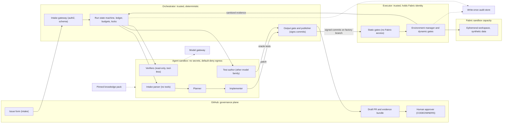
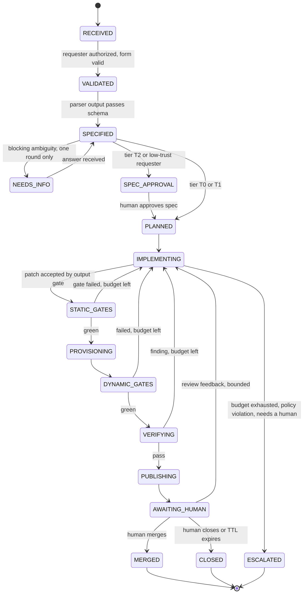

# Fabric Code Factory — Design

Version 0.1 · 2026-10-30 · Status: first full draft for review. Not yet validated by the model panel, and the claims it rests on are still in cross-verification.

Inputs: requirements v0.2 (`01-requirements.md`), decision register v0.1 (`02-decision-register.md`), landscape digest v0.1 (`03-landscape-research.md`), raw reports T1 to T7 and O1 (`research/raw/`).

Reference keys: FR-nn and NFR-nn are in the requirements. D-nn are in the decision register. C1 to C15 are the minimum security controls and G1 to G16 the quality gates, both in the landscape digest. S1 to S6 are the pilot success criteria in the requirements. HR-n are the hard rules below.

## 1. Summary

The factory turns a GitHub issue into a verified draft pull request against Git-backed Fabric item definitions, then stops and waits for a human.

1. **Git is the source of truth and the human control plane.** Fabric workspaces are downstream of Git.
2. **Agents propose, a deterministic executor disposes.** Agents see only a repo clone and sanitized evidence. They hold no repository-push, Fabric or billing credentials. Every write passes an output gate.
3. **A durable state machine drives every run.** Each stage is idempotent, checkpointed, budgeted and cancellable, so a host restart cannot lose or duplicate work.
4. **Doer is not judge.** A separate test author writes the oracle tests, separate verifiers from other model families review, and deterministic gates decide.
5. **Validation happens in an ephemeral sandbox workspace** on a dedicated capacity with synthetic data.
6. **The factory never merges, approves or promotes.** A human approves a PR that carries an evidence bundle.
7. **Knowledge is pinned.** Official Fabric skills plus a factory plugin, scanned and evaluated against a golden suite before every change.
8. **Work is sized to about one human-hour.** Larger requests are split by a human or escalated. Security-sensitive changes are out of autonomous scope in v1.
9. **Pilot slice:** semantic models and reports first, then data agents and ontology.
10. **Build thin, prove, then harden.** Phase 0 spikes test the platform assumptions before any build. The first runtime is GitHub Actions, and a durable orchestrator comes later.

"Silent" means no human interaction while a run executes. People are told when a PR is ready or when the run escalates.

## 2. Hard rules

Every component obeys these. A design change that breaks one needs a decision record.

| ID | Rule |
|---|---|
| HR-1 | Git is the source of truth. One writer per branch. `factory/*` branches are written only by the publisher. Factory-managed workspaces are downstream-only: nobody commits from them. |
| HR-2 | Agents propose, the executor disposes. Agent output is declarative (a patch, a spec, a verdict). Only trusted code applies it. |
| HR-3 | No agent holds repository-push, Fabric or billing credentials. Model access is proxied. |
| HR-4 | Intake text is data, never instructions. It cannot widen permissions, change policy or choose credentials. |
| HR-5 | The implementer never writes or edits the oracle tests that judge its change, and never sees the hidden checks. |
| HR-6 | Deterministic gates decide. AI reviewers advise and can only add blocks, never remove them. |
| HR-7 | Every stage is idempotent, checkpointed, budgeted and cancellable. Retries are bounded. |
| HR-8 | In v1 the factory never merges, approves, promotes, deletes outside its own sandbox, or touches permissions, RLS or OLS, connections, sensitivity labels, schedules, or tenant or capacity settings (risk tier T3). |
| HR-9 | Everything the factory loads (skills, templates, MCP servers, CLIs, gates, policies) is pinned by version or digest, scanned, and versioned. No run-time installs from the open internet. |
| HR-10 | Evidence over narration. The PR's evidence is generated from run artifacts, not from model prose. |
| HR-11 | A gate is never weakened to get a pass. The only exits from a failing gate are a fix, an escalation, or a human decision recorded in the PR. |

## 3. Architecture

### 3.1 Zones and trust boundaries

Trust boundaries that matter:

- **GitHub to orchestrator:** issue text is untrusted. Only an allow-listed requester can start a run.
- **Orchestrator to sandbox:** the sandbox receives a spec and a clone, and returns patches and verdicts. It has no credentials and default-deny egress (model gateway and a package mirror only). Egress is enforced for every process, including MCP servers: the Copilot cloud agent's own firewall covers only processes started through its shell tool.
- **Sandbox to executor:** the executor accepts only commit SHAs and typed operations. It never runs agent-supplied commands.
- **Executor to Fabric:** only workspaces on the sandbox capacity that the executor created. Agent-authored code (notebooks, pipelines) does run there, under a separate low-privilege identity (section 3.5).

### 3.2 Components

| ID | Component | Responsibility | Trust | First implementation (D0) | Durable implementation (D1) |
|---|---|---|---|---|---|
| C1 | Intake gateway | Authenticate requester, validate the form, write the intake record, label | Trusted | Actions workflow on issue events, allow-list check | Same, plus a webhook to the orchestrator |
| C2 | Orchestrator | State machine, run ledger, locks, budgets, retries, kill switch | Trusted | Actions workflows with `queue: max` concurrency groups (up to 100 queued runs). Ledger on an orphan branch. Work-in-progress commits as checkpoints | Durable Task Scheduler orchestrations and activities. Ledger in a database. Artifacts in blob storage |
| C3 | Agent runtime | Run role sessions in the sandbox | Untrusted | Ephemeral runner with headless Copilot CLI, egress allow-list | Container jobs with the Copilot SDK in server mode on durable storage |
| C4 | Output gate and publisher | Validate each patch, push signed commits, open and update the PR, set status checks | Trusted | A separate job with its own token | An activity with its own identity |
| C5 | Static gate runner | G1 to G3, G10, secret scan, integrity guard. Treats agent files as data and never executes them | Trusted | Job without Fabric credentials | Activity |
| C6 | Executor | Typed operations against the sandbox: create, deploy, post-deploy, test, evidence, teardown, sweep | Trusted | Job bound to a GitHub Environment, authenticated by OIDC | Activities on container apps with a managed identity |
| C7 | Verifier panel | Independent, read-only reviews | Outputs untrusted | Job calling headless Copilot with other model families | Same through the gateway |
| C8 | Knowledge pack loader | Fetch the pinned bundle, verify digests, scan it | Trusted | Step | Image build |
| C9 | Evaluation harness | Golden set, red-team set, regression, shadow, canary, drift probes | Trusted | Scheduled workflows in a separate repo | Same |
| C10 | Audit and telemetry | Ledger, traces, evidence store, dashboards | Trusted | Artifacts with attestations, signed ledger commits | Write-once blob storage, Log Analytics |
| C11 | Policy as code | Allow-lists, blocklists, tiers, thresholds, budgets | Trusted | Protected repo, two approvers | Same |

The same state machine and ledger schema run in both columns. Moving from D0 to D1 replaces the runtime, not the design.

### 3.3 Run lifecycle

Rules that the diagram does not show:

- **Any state can end in CANCELLED** through the kill switch (section 3.16). Infrastructure failures retry with backoff and then end in ESCALATED with an infrastructure flag.
- **Every transition is a ledger event** carrying the run ID, stage, input digest and idempotency key. A resumed run re-enters the last incomplete stage and skips completed ones.
- **Budgets per unit (proposed defaults to calibrate):** at most 6 implement-and-static-gate iterations, at most 3 dynamic cycles, a wall-clock cap, token and dollar caps. The same failure signature twice forces a plan revision once, then an escalation.
- **End states:** DONE (PR open), PARTIAL, BLOCKED and ABANDONED each leave a draft PR or an issue comment with a failure report. Partial work is never merged.
- **Escalate is always available to the implementer.** Offering an explicit "I cannot do this, ask a human" action reduced test cheating in the ImpossibleBench study.

### 3.4 Roles and models

Model per role is configuration, not code. Defaults follow the operating model: Sonnet 5.5 leads, and GPT 6.1 Sol, Gemini 4 Argon and Grok 4.7 judge.

| Role | Purpose | Default model | Tools | Sees | Cannot |
|---|---|---|---|---|---|
| Intake parser | Turn the issue into a schema-valid spec | Sonnet 5.5 | None | Sanitized issue text, form fields | Use tools, see secrets, see the repo |
| Planner | Items to change, order, impact analysis, test plan, rollback plan, size and tier | Sonnet 5.5 | Read-only repo, offline Fabric docs | Spec, clone | Write |
| Test author | Oracle tests from the spec before implementation | GPT 6.1 Sol | Read-only repo, offline Fabric docs | Spec, schema, fixtures | See the implementation |
| Implementer | Change item definitions inside a bounded loop | Sonnet 5.5 | Write to its clone, run static gates | Spec, plan, visible oracle tests, sanitized failure evidence | Push, call Fabric, edit protected paths, see hidden checks |
| Verifiers | Judge diff against spec and evidence | GPT 6.1 Sol, Gemini 4 Argon, Grok 4.7 (a family other than the implementer's) | None | Spec, plan, diff, sanitized evidence | Use tools, modify anything |

Notes:

- The DAX LLM Benchmark v2 (2026-10-27, verified: 94 single-shot tasks, DAX writing only) scores Sonnet 5.5 lowest of the four at single-shot DAX writing (84.6% against 87.5% to 91.4%). Gates make this tolerable, and the golden suite decides whether a DAX-heavy pack should route drafting to another model.
- Verifier verdicts are advisory evidence. They can add a block, never remove a deterministic one (HR-6).
- Verifiers are tool-less and read-only. This follows the independent-critic pattern with a fail-safe of applying no patch.

### 3.5 Identities and secrets

| Identity | Type | Rights | Never |
|---|---|---|---|
| Requester | Human (GitHub) | File an issue, cancel own run | Approve own PR |
| Approver | Human, CODEOWNERS | Approve and merge | Be the requester |
| `factory-intake` | GitHub App | Read issues, comment, label | Contents write |
| `factory-publisher` | GitHub App | Contents write on `factory/*` only (ruleset), PR and checks write. Signs commits with a key held outside the sandbox | Be in any bypass list, approve, merge |
| Agent sandbox | None | Proxied model calls | Push, call Fabric, hold secrets |
| `fcf-deployer` | Entra service principal or managed identity, via OIDC federated credential bound to a GitHub Environment | Create and delete workspaces on the sandbox capacity, Admin on the workspaces it creates | Hold any role on dev, test or production |
| `fcf-runner` | Separate service principal or managed identity | Contributor on one ephemeral workspace, granted at creation | Touch any other workspace |
| `fcf-capacity` | Azure RBAC | Resume and pause the sandbox capacity only | Anything else |
| `fcf-devsync` | Separate identity behind an Environment with required reviewers | Sync the dev workspace after merge | Be used by agents |
| Git credential inside Fabric | PAT (GitHub) or service principal (Azure DevOps) in a Fabric connection | Created by a human admin, used only by deployment path A | Be visible to the factory |

Why two Fabric identities: agent-authored notebooks and pipelines run in the sandbox workspace as whoever triggers them. Running them as `fcf-runner`, which holds one workspace only, keeps the deployer's rights out of reach of code under test. Whether Contributor is enough to run every item type's tests is a Phase 0 question.

Constraints: Entra allows at most 20 federated credentials per identity and does no wildcard matching, so bind trust to GitHub Environments, not branches. Provision credentials serially, because concurrent creation on one managed identity fails with HTTP 409. Fabric service-principal access is bounded by workspace roles and tenant settings, not OAuth scopes, so the blast radius comes from the roles granted.

### 3.6 Git model and review path

- **Layout in the target repo:** `workspaces/<alias>/<Item>.<Type>/...` in Fabric Git format. `specs/<issue>.yaml` for the spec. `factory-oracle/<issue>/` for visible oracle tests (written only by the test-author role, read-only to the implementer). The policy, evaluation and knowledge-pack repos are separate.
- **Branches:** `factory/<issue>-<slug>`, written only by the publisher. Every iteration is a signed commit with trailers: `Factory-Run`, `Factory-Iteration`, `Co-authored-by` (the requester).
- **Rulesets on `main`:** required checks (`factory/static`, `factory/dynamic`, `factory/integrity`, `factory/evidence`, plus normal CI), CODEOWNERS review on item folders and on protected paths, at least one human approval (two for app-authored PRs touching T2 content), stale approvals dismissed, approval of the most recent push required, requester is not approver, empty bypass list.
- **PR:** opened as a draft by the publisher. Marked ready for review only when every required check is green. The body is the one-page summary (section 3.17).
- **After merge:** a separate `dev-sync` workflow under `fcf-devsync` updates the dev workspace from `main`. In the pilot it waits for an Environment approval. Promotion beyond dev is never automatic.
- **Drift:** a scheduled job compares the dev workspace's definitions with `main` using a normalizing diff (auto-rebound fields removed) and opens an issue on drift. Policy: nobody commits from the workspace to `main`.

### 3.7 Fabric sandbox environment

- **Capacity:** one dedicated small F-SKU capacity for the factory, separate from demo and production capacity. An F SKU is required for data agents (trial is not enough) and for outbound access protection. Throttling and smoothing are capacity-wide, so concurrent dynamic stages are capped (start at 1, raise after measurement).
- **Capacity lifecycle:** `fcf-capacity` resumes the capacity when a run needs it and pauses it after an idle window. Pause and resume goes through Azure Resource Manager (to confirm in Phase 0). Pausing makes all content unavailable and bills the carry-forward, so the pause is reference-counted and never fires during a run. Any scheduled nightly pause must exclude this capacity.
- **Workspace per run:** `fcf-<repo>-<issue>-<shortsha>`. Description and tags carry the run ID. The executor keeps a registry of the workspaces it created, and every Fabric call is checked against it, so it can never act on a workspace it did not create.
- **Retention:** kept until merge, close or a time-to-live (default 24 hours, to calibrate), then deleted. Deletion is soft (7 days by default) and still bills storage, and Git can resurrect deleted items with new IDs, so a sweeper deletes orphans and purges soft-deleted workspaces where the admin API allows.
- **Data:** synthetic and deterministic (seeded generators in the repo), loaded by post-deploy jobs. No shortcuts or links to real data. Semantic models are rebound to synthetic sources by deployment parameters and a variable-library value set. Real data is out of scope in the pilot.
- **Network:** workspace outbound access protection where the item types allow it. It needs an F SKU, is preview, and excludes reports. Synthetic data keeps the residual risk low.
- **Reviewer access:** read-only access for a reviewers group, so a human can open the deployed result.

### 3.8 Validation deployment path (D-10)

Two ways to put a branch into the ephemeral workspace:

| | Path A: Git-connected branch workspace | Path B: definition push with `fabric-cicd` |
|---|---|---|
| Mechanism | Create workspace, connect to the branch, initialize, update from Git, optional workspace relation | Create workspace, deploy the checked-out SHA with `fabric-cicd` and a parameter file |
| Credentials | A PAT (GitHub) or service principal (Azure DevOps) stored in a Fabric connection | None stored in Fabric. The runner holds Git access |
| Service principal limits | Update from Git works only if every item in the workspace supports service principals | Per-item API support, 31 item types including data agent, ontology, report and semantic model |
| Maturity | Git support is preview for semantic model, report and warehouse | Open source, full deploy each run |
| Parity with dev | Same mechanism as the dev workspace | Different mechanism, so it needs a parity check |

**Provisional choice: B for validation, A for the post-merge dev sync.** B keeps the Git credential out of Fabric, deploys exactly the commit under review, and avoids the single-writer coupling of a Git-connected ephemeral workspace. The price is that validation and dev sync use different mechanisms, so a scheduled parity job deploys `main` both ways and diffs the results. This is a leaning, to be settled by Phase 0 spikes S3 and S4.

### 3.9 Output gate and executor operations

**Output gate (C4).** Every patch from an agent role is checked before it reaches a branch. Any failure rejects the patch and returns a structured reason to the agent.

| Check | What it enforces |
|---|---|
| Path policy | Allow-list per pack and tier: the targeted item folders, `specs/<issue>.yaml`, the implementer's own test paths. Deny-list: `.github/**`, `CODEOWNERS`, `factory-oracle/**` (test-author only), policy and golden sets, `*.schedules`, role, RLS and OLS definitions, connection and credential files, logical-ID changes on existing items |
| Size | Caps on files, changed lines and bytes per patch and per PR (values to calibrate) |
| Serialization | Fabric's format: LF, no trailing newline, so no phantom diffs |
| Secrets and PII | Secret scanner and PII patterns on every added line |
| Operation blocklist | Semantic diff blocks item deletion, item-type changes, new external shortcuts, new schedules, data-source changes, any permission change |
| Test integrity (HR-11) | Blocks deleted, skipped or renamed tests, removed assertions, relaxed tolerances or thresholds, changed gate configuration, snapshot rewrites without a human-approved label |
| Supply chain | No new dependency, MCP server or skill unless allow-listed |
| Content warning | Instruction-override phrasing in added descriptions, comments and data-agent instructions raises a flag for the human reviewer. It is a warning, because data-agent instructions legitimately instruct a model |

Accepted patches are applied and pushed by the publisher as signed commits.

**Executor operations (C6).** The executor exposes a small set of typed operations. Agents can request only these, only through the orchestrator, and only for the current run.

| Operation | Effect |
|---|---|
| `static.run(sha, gates)` | Run static gates on the commit, with no Fabric access |
| `cap.acquire(run)`, `cap.release(run)` | Reference-counted resume and idle pause of the sandbox capacity, under a budget |
| `env.create(run, sha)` | Create the ephemeral workspace, assign the capacity, grant `fcf-runner` and the reviewers group |
| `env.deploy(env, sha)` | Deploy the commit with the parameter file for the sandbox |
| `env.postdeploy(env, fixtures)` | Seed synthetic data, bind connections, set the variable-library value set, refresh, wait for steady state |
| `env.test(env, suite)` | Run visible and hidden oracle tests and the regression suite, each twice |
| `env.evidence(env)` | Collect results, screenshots, diffs and metrics |
| `env.teardown(env)`, `env.sweep()` | Delete the run's workspace, delete orphans, purge soft-deleted workspaces where allowed |

Invariants for every operation:

- **Plan, apply, verify.** Verification reads the state back and compares parsed content, because HTTP 200 is not proof and Fabric re-serializes JSON.
- **Idempotent.** The key is the run, the operation and the input digest. A retry after a lost response must not create a duplicate workspace or job.
- **Registry-bound.** Every Fabric target must be in the run's registry of workspaces the executor created.
- **Ledgered.** An event is written before and after each call.
- **Locked and budgeted.** One lock per workspace, plus the capacity budget.
- **Well behaved against the API.** Backoff on HTTP 429, polling of long-running operations, the vendor telemetry header on every call that the owning skill requires.
- **No permission changes** except granting `fcf-runner` and the reviewers group on the run's own workspace.

**Tool surface.** Unattended runs are REST-first with service principals or managed identities, through `fabric-cicd`, the Fabric CLI and REST. MCP servers are author-side tooling: agents may use offline documentation tools and a read-only local Power BI Authoring MCP. The FabricIQ MCP (service principals explicitly unsupported) and the ontology MCP are user-only, and the hosted Core MCP documents only browser OAuth, so they stay out of the unattended path.

### 3.10 Quality gates by workload pack

Gate numbers are from the landscape digest. Thresholds live in `factory-policy/gates.yml`, a protected file, and are calibrated in Phase 1.

| Pack | Phase | Static gates (every iteration, no Fabric) | Dynamic gates (sandbox) | Gaps to build |
|---|---|---|---|---|
| Semantic model | Pilot | G1 TMDL parses, G2 best-practice rules, G3 reference integrity, secrets, integrity guard, roles unchanged (T3 guard) | G4 deploy and refresh, G8 golden DAX, G9 measure tests on synthetic data, G14 performance, G15 impact | Golden-DAX harness (the Tabular Editor `te` test is preview and its docs give two expiry dates), impact report |
| Report | Pilot | G1 PBIR validate, G10 structure lint, G3 fields exist in the bound model, integrity guard | Deploy, headless screenshot or `exportToFile` PNG, broken-visual check, G11 visual diff against baseline (a human reviews diffs) | Image diff and thresholds. Distribution of `powerbi-report-author` unverified |
| Data agent | Phase 2 | Definition parts validate against the public JSON schemas, instruction lint, selected data sources exist | Publish, evaluate golden Q&A (visible and hidden), deterministic match first then an LLM critic, repeated k times against a baseline pass rate | Whole pack: no official skill. Service-principal path for evaluation unverified (spike S6) |
| Ontology | Phase 2 | Validate the new TMDL-based format | Unverified | Pack and test route. The old format retires 2027-01-31 |
| Notebook and pipeline | Phase 4 | Lint, parameter checks | Job run with `exitValue`, data tests, idempotent re-run, G5, G6, G7 | Data diff |
| Lakehouse and warehouse | Phase 4 | Contract check, SQL project checks | Contract tests, data diff against a clone | Data diff |

Every pack also gets the common gates: secret and PII scan, protected-path guard, integrity guard, serializer conformance, size cap.

### 3.11 Verification and test integrity

Layers, strongest first:

1. **Deterministic gates** (3.10). They decide.
2. **Oracle tests.** The test author writes executable tests from the spec before implementation, using the spec's worked examples and the known values of the synthetic data. The visible set is committed under `factory-oracle/<issue>/visible/`. For tier T2, a hidden set, written from the same spec with different examples, is kept in the run's audit store and executed by the executor. The implementer sees only pass or fail and a category for hidden checks. The human reviewer sees both sets afterwards. Merged oracle tests become regression tests that later runs may not weaken.
3. **Integrity guard** (3.9). Deterministic, with no model in the loop.
4. **Verifier panel.** T0: deterministic gates only. T1: one verifier from a family other than the implementer's. T2: two verifiers from different families. Disagreement is not settled by vote: the run escalates with both views. Verifier output is schema-validated (per-criterion verdict, risk findings, integrity concerns, a "not verified" list, confidence) and never forwarded as free text.
5. **Repeat runs.** Each dynamic test runs twice to expose non-determinism.
6. **Mutation and property tests.** A phase 2 add-on for T2 logic.

Everything one model produces is untrusted input to the next stage, so cascading injection between agents cannot pass through free text.

**Definition of done for a factory PR:**

1. A linked intake and a schema-valid `spec.yaml` with Given, When, Then criteria, tier and assumption ledger.
2. Scope matches the plan, one logical change, inside the size cap.
3. All static gates green: no secrets, no integrity or permission tampering.
4. Branch deployed to an isolated workspace with no manual step, and teardown or time-to-live logged.
5. Every criterion has at least one executable test, passing on two clean runs.
6. Pre-existing tests unchanged and green. Reconciliation checks pass.
7. Verifier panel complete for the tier. Findings resolved or listed.
8. Evidence bundle complete, including versions, cost, rollback plan and "not verified".
9. Draft PR with signed commits and run links.
10. No tier T3 content.
11. The factory cannot approve or merge. The requester is not the approver.
12. No budget exceeded.

### 3.12 Intake, spec, tiers and sizing

**Issue form fields** (`factory-request.yml`, answers become the issue body): target (dropdown from the allow-list of repo and workspace aliases), request type, business goal, current versus desired behaviour, worked examples with expected numbers (required for measures and data changes), scope hints, grain, time and filter semantics (required for measures), audience and data class (anything other than synthetic or internal is refused in the pilot), non-goals, optional named approver, and an acknowledgement that no secrets or personal data are included.

**Triage** returns go, clarify or stop, plus size, tier and packs.

| Tier | Meaning | Handling |
|---|---|---|
| T0 | Documentation, descriptions, annotations, report formatting with no logic | Deterministic gates only |
| T1 | Additive change in dev scope: a new measure, column, visual, page or instruction that does not alter existing behaviour | Gates plus one verifier |
| T2 | Change to existing shared behaviour: modify or rename objects with consumers, pipeline or notebook logic, data-agent instructions that change answers | Spec approval, impact analysis, hidden checks, two verifiers |
| T3 | Security, RLS and OLS, permissions, PII, connections, schedules, destructive or production-data writes, tenant or capacity settings | Refused in v1. A human implements, with two approvers |

Tier is computed by deterministic rules over the plan's item types and operations. The planner or a verifier can raise it, never lower it.

**Sizing.** The planner estimates human-equivalent effort and item count. The cap is about one hour and a small item count (to calibrate). Above the cap the run posts a decomposition proposal (ordered units with dependencies) and stops. A human splits it into issues. The pilot supports single-unit requests only. The reason is evidence: METR's frozen measurements put the 80%-reliability horizon of frontier models at about 0.9 to 3.1 hours on clean tasks, so messy BI requirements will do worse. The cap is calibrated on the golden set, not fixed.

**Clarification.** At most one batched round, only for blocking ambiguity (no executable criterion, or unresolvable items). Otherwise proceed and list assumptions in the PR. After an answer, restart from the consolidated spec rather than continuing a long conversation. A run with no answer for 7 days (configurable) ends ABANDONED.

**Duplicates and conflicts.** At intake, look up open intakes, PRs and factory branches touching the same items, by path overlap and similarity. Link them. Serialize runs that touch the same item folders through a lock. Never auto-close.

**Spec approval.** Required for T2 and for requesters outside the trusted sub-group, by a human with CODEOWNERS rights on the target items. Spec quality is the dominant lever, and about 30% of tasks in a widely used public benchmark were found broken, so we expect our own acceptance criteria to carry similar defects.

### 3.13 Knowledge pack

| Part | Contents |
|---|---|
| Official plugins, pinned | `fabric-skills` and `powerbi-authoring` at a tagged release (installed v0.3.19, upstream v0.3.20 at the time of writing), vendored by digest, update check disabled. Never auto-update |
| Factory plugin `factory-*` | `factory-intake-spec`, `factory-plan`, `factory-oracle-tests`, `factory-dataagent-pack`, `factory-ontology-pack`, `factory-validation-harness`, `factory-evidence`, `factory-review`, `factory-redteam` |
| Templates | Issue form, PR template, spec schema, item templates, synthetic-fixture generators |
| Conventions | A map of about 100 lines (AGENTS.md style) plus modular docs. No document over about 10k tokens |
| Golden examples | Curated, approved factory PRs per pack |
| Policy (separate protected repo) | Allow and deny lists, tier rules, gate thresholds, the data-class to model matrix |
| Lock file | `knowledge.lock` with versions, SHAs and digests of every source |

Lifecycle:

- Changes arrive as PRs. CI lints the pack (description length, with the Agent Skills specification capping it at 1,024 characters, trigger overlap, and size), runs the prompt-security and secret scans, and runs the golden regression suite. A human approves (two approvers for policy). A tag is cut and the loader pins it.
- A weekly job watches upstream releases and opens a refresh PR with a gap analysis. It never auto-merges.
- Roll back by reverting the tag.
- Upstream skills assume an interactive confirmation that an unattended run lacks. The pack therefore carries a rule: any step that asks for approval means escalate, and destructive operations are blocked by the executor regardless.
- Public skill registries carry real flaws (a vendor study found 36.8% of about 4,000 had one), so nothing outside the pinned bundle is loaded.

### 3.14 Models and gateway

- **D0:** headless Copilot with the organisation's billing policy: model enablement, per-provider zero-retention terms, AI-credit budgets (a soft cap: one response can exceed it), audit log. All four models are GA there. Role to model is configuration.
- **D1:** an API Management AI gateway for bring-your-own-model (Azure-hosted Claude, GPT and Grok through Foundry, Gemini through Google Cloud), with token quotas, metrics, content safety and managed identity. LiteLLM is avoided unless patched and private (three Critical advisories in 2026, and budgets fail open without a database).
- **Worker details (D1).** The Copilot CLI has no official container image, so we build and pin our own. Its headless endpoint has no authentication, so it binds to loopback. A 1-hour GitHub App installation token cannot be refreshed in place, so the worker restarts its SDK client when the token is renewed.
- **Data-class matrix (C12).** SYN (synthetic, demo, internal) goes to all four models. Customer code without data goes only to vendors whose terms policy accepts. Customer data is out of scope in the pilot. Prompts carry schemas and synthetic samples, never rows. Anthropic's 30-day retention applies to Mythos-class covered models only (Fable and Mythos), and Sonnet 5.5 keeps zero data retention. Gemini uses durable caching (up to 24 hours), Anthropic beta features fall outside zero retention, and the Grok terms are unverified.
- **Pinning and drift.** Pin the model per deployment, log model IDs in every PR, run a daily probe subset, and keep a second family as failover for each role. Providers have regressed pinned models silently before.

### 3.15 Evaluating the factory

- **Golden set** per pack: 20 to 50 audited, real requirements with reference solutions and oracle tests, held out in a private evaluation repo that runs cannot reach. Refresh monthly. A task with 0% pass is treated as broken.
- **Red-team set:** injection payloads through every intake channel (issue body, linked documents, in-tenant descriptions, poisoned skills and tool descriptions), test-tampering temptations, exfiltration attempts, T3 requests, oversized and duplicate requests. Success means the factory blocks or escalates (pilot criterion S3).
- **Regression:** any change to prompts, skills, models, gates or policy runs the regression suite (about 100% must pass) and the capability suite (tracked, starts low), with `pass^k` for k = 3.
- **Shadow then canary:** draft PRs on real intakes while humans deliver, then T0 and T1 only in the pilot repo.
- **Drift probes:** a daily subset against the pinned models.
- **Metrics, pre-registered:** acceptance without rework (merged within one review round, by pack and tier), time to PR and time to merge reported separately, rework rate, escaped defects (rollbacks, incidents and change failures within 14 days), cost per merged change against a human baseline, review minutes per PR, clarification rate, share ending PARTIAL, BLOCKED or ABANDONED, seeded-defect catch rate of gates, and reviewer catch rate on canary PRs with seeded defects. Self-reported time savings are ignored.
- **Benchmarks:** none covers Fabric item types except DAX writing. Use the DAX benchmark only as a model-selection input. Build and audit our own sets.

### 3.16 Operations

- **Kill switch:** a `FACTORY_HALT` variable checked at every stage entry, a `factory:cancel` label per run, and a tested revoke path (disable the GitHub App installations, revoke the Entra federated credentials, block egress).
- **Budgets:** per run (iterations, tokens, dollars, wall-clock, capacity-seconds) and per day, with concurrency caps. Excess runs queue.
- **Observability:** run ID equals trace ID. OpenTelemetry GenAI spans with content redacted, executor spans, ledger events, and dashboards for pass rates, time, cost and queue depth. Alerts for stuck runs, budget breaches, orphan workspaces and a capacity left running.
- **Audit:** signed commits with the key outside the sandbox, signed ledger commits, attested evidence bundles, a write-once store (artifact attestations in D0, immutable blob storage in D1), audit alerts on the factory identities, a quarterly access review.
- **Incidents:** a runbook (halt, revoke, sweep workspaces, review the ledger), a credential-rotation drill, a named on-call.
- **Reporting:** usage and cost per run, requester and pack (FR-26).
- **Calendar to watch:** the old ontology experience retires 2027-01-31, Git needs read-write on items from 2027-02-28, the Copilot SDK is being renamed, MCP spec 2026-07-28 is current, and several agent vendors are shutting products down.

### 3.17 Reviewer experience and the evidence bundle

The human is the scarcest resource. Reviewer load doubled in at least one large enterprise study, and users accept 93% of manual approval prompts in one vendor's data, so the design makes the review small and honest.

- One logical change per PR, a hard size cap, a risk-ranked summary first, then hotspots, then detail.
- The bundle is generated from run artifacts: spec link and tier; diff summary by item; a criterion, test, result and run-link table; the gate table; data-check results; screenshots and visual diffs; assumptions and a "not verified" list; verifier verdicts and any disagreement; the hidden checks (after the run); cost and time; versions of models, knowledge pack, gates and skills; the rollback plan (revert commit and sandbox link); provenance (run ID and session links).
- A reviewer work-in-progress limit and an SLA. Approver is never the requester. T3 changes made by humans need two approvers.
- Occasional canary PRs with a seeded defect measure whether reviewers catch it.
- Notifications through GitHub for PR ready, escalation (with the failure report) and spec approval requests. Teams can be added later.

## 4. Security design

### 4.1 How the design answers the top attack paths

The threat model ranks 15 attack paths by likelihood times impact (landscape digest section 5). The structural answer is in the stage separation: the implementer sees untrusted input and can change state, but holds nothing sensitive. The executor holds the Fabric identity and can change state, but takes only commit SHAs and typed operations. No single component has all three of untrusted input, sensitive access and the ability to act.

| Rank | Attack path | Design answer | Residual risk |
|---|---|---|---|
| 1 | Intake injection leaks secrets through an open channel | HR-3 and HR-4. The parser has no tools. The sandbox has no secrets and default-deny egress. Output gate scans every patch | Covert content in PR text or a patch, caught only by the gate and the human. The model-gateway token allows inference only and is budget-capped |
| 2 | Over-privileged Fabric identity | Two identities with no role on dev, test or production. Dedicated sandbox capacity. Registry-bound executor. Tier T3 refused | Tenant-level service-principal settings. Keep identities in one security group with no admin roles, and verify in spike S2 |
| 3 | Agent-authored notebook or pipeline exfiltrates or reaches production | Synthetic data only. Runs as `fcf-runner` with one workspace. No shortcuts or connections allowed. Outbound access protection where available | Outbound access protection is preview and excludes reports. Exfiltrating synthetic data has low value |
| 4 | Confused deputy: a requester gets what they should not | Allow-listed requesters per target. CODEOWNERS on item folders carries authorization. Permissions, RLS and OLS are T3 and refused | The factory cannot read Fabric entitlements, so GitHub ownership must mirror them. Reviewed per target at onboarding |
| 5 | Reviewer rubber-stamps a defective PR | Section 3.17: size cap, risk-ranked evidence, two approvers for T2, canary PRs. Deterministic gates carry recall | Human fatigue remains. Measured by canary catch rate |
| 6 | Poisoned skill, template or MCP tool description | HR-9. Pinned, scanned, allow-listed. No run-time installs. Offline documentation tools only | A malicious upstream release passing the scan. Refresh PRs are human-reviewed and gated by the golden suite |
| 7 | Malicious or typosquatted package or Action | Allow-listed package mirror, lockfiles, no install scripts, Actions pinned by SHA, static workflow analysis in CI | Zero-day in a pinned dependency |
| 8 | Agent edits its own guardrails | Protected paths, separate policy and evaluation repos, CODEOWNERS, rulesets, required checks from a pinned App, output-gate deny-list | Misconfigured ruleset. Verified by a red-team test |
| 9 | Compromise of the factory's repos or runners | No `pull_request_target`, SHA-pinned Actions, ephemeral runners, OIDC only, no long-lived tokens except the Git credential in Fabric (path A only) | Compromised maintainer account. Two-person policy changes |
| 10 | Reward hacking | Integrity guard, oracle tests, hidden checks, escalate action, repeat runs | Special-casing that passes visible tests. Hidden checks and review |
| 11 | In-tenant content poisoning | Agents never read tenant content directly. They see the repo and sanitized evidence. Content-warning flag | Poisoned text already in the repo |
| 12 | Vendor data exposure | Data-class matrix. Synthetic data only. Schemas not rows. Gateway logging | Vendor retention terms are partly unverified |
| 13 | Runaway cost or capacity exhaustion | Per-run and per-day budgets, concurrency caps, reference-counted capacity, kill switch | A misconfigured budget. Alerts |
| 14 | Evidence tampering | Signing key outside the sandbox, write-once store, attestations | Insider with store access |
| 15 | Cascading injection between agents | Schema-validated structured outputs. Verifiers are tool-less. Free text never flows forward | Schema fields that carry free text, kept short and sanitized |

### 4.2 Control readiness by phase

The minimum controls C1 to C15 are go-live gates, each to be demonstrated, not merely configured. The pilot only touches the sandbox, so they are staged.

| Phase | Controls that must be demonstrated before the phase starts |
|---|---|
| 1 Thin slice | C1 separation of duties, C2 no standing secrets in the sandbox, C3 stage separation, C4 egress control, C5 Fabric blast radius, C7 protected paths and oracle integrity, C9 output gate, C11 budgets and kill switch |
| 2 Harden | Adds C8 supply-chain pinning, C10 audit and provenance, C12 data-class matrix, C13 intake authentication, C14 red-team gate |
| 3 and beyond | Adds C15 incident readiness with a rehearsed drill, and C6 before any promotion automation exists |

### 4.3 Accepted residual risks for the pilot

- Preview features (Git for several item types, outbound access protection, hosted MCP servers) can change without notice.
- Human reviewers remain the last line of defence for subtle defects.
- Vendor retention terms for some models are unverified, so the pilot uses synthetic and internal content only.
- The factory trusts GitHub and Entra as control planes.

## 5. Roadmap

Phases are sequenced, not dated. Effort tags are rough: S is days, M is a few weeks, L is more.

### 5.1 Phase 0: foundations and spikes (effort M)

Each spike has a success criterion. The phase exits when S1 to S5, S7 and S8 pass or the design is adjusted, decisions D-03, D-09, D-10 and D-11 are closed, and a service-principal support matrix for the pilot item types is written down.

| Spike | Question | Success criterion |
|---|---|---|
| S1 Git baseline | Can the pilot workspace be backed up to Git and diffed without noise? | Clean round trip for a semantic model and a report. No phantom diffs. The one-writer rule documented |
| S2 Identity and switches | Can service principals create workspaces on the sandbox capacity, with the right roles, through OIDC? | Workspace created by the deployer. The runner holds Contributor on one workspace only and can run a notebook job and a DAX query (some job types lack service-principal support). Tenant switches, the GitHub or Azure DevOps Git credential and the 20-credential limit settled |
| S3 Path B round trip | Create, deploy with `fabric-cicd`, post-deploy, test, screenshot, tear down | End to end with no manual step, deterministic over three runs, time and capacity use measured |
| S4 Path A comparison | Git-connected branch workspace with workspace relation, including the beta deployment plans with pre and post actions documented on 2026-10-22 | Parity diff against path B and a decision on D-10 |
| S5 Kill the runner | Kill the runner mid-stage and resume | 100% resume with no duplicate workspace or job |
| S6 Data agent as a service principal | Define, publish and evaluate a file-defined agent | A supported path, or a documented fallback with a human-approved step |
| S7 Injection red team | Payloads through issue, parser and implementer | Zero leaks. All seeded payloads blocked or flagged |
| S8 Capacity lifecycle | Resume and pause by managed identity, two concurrent runs | Concurrency cap, idle policy and per-run capacity cost set |
| S9 Model routing | Four models by role through headless Copilot on Actions | Role to model table, per-run cost, written retention terms, DAX mini-set per model |
| S10 Knowledge pack | Pinned official plugins in the sandbox | Reproducible image digest, scanners passing, update check off, telemetry header handled by the executor |

### 5.2 Later phases

| Phase | Scope | Exit criteria |
|---|---|---|
| 1 Thin slice (D0), effort M | Semantic model and report packs. T0 and T1 only. Single-unit requests. Shadow mode first, then canary | S1: at least 70% of a golden set of about 20 pass every gate within two iterations. S2: zero policy violations. S4: median reviewer time 15 minutes or less |
| 2 Harden and extend, effort L | C1 to C15 demonstrated. Golden and red-team sets in CI. Kill-switch drill. Data agent and ontology packs. T2 changes with hidden checks and two verifiers. Metrics baseline | S3: at least 90% of seeded defects caught. S5: at least 60% of PRs accepted within one revision |
| 3 Durable orchestrator (D1), effort L | Durable Task Scheduler, API Management gateway, concurrency, a second target repo, dashboards | Resume proven at scale. S6: cost per accepted change inside the requester's budget |
| 4 Widen workloads, effort L | Notebook, pipeline, lakehouse and warehouse packs. Data diff. Real-time items | Per-pack golden sets reach their targets |
| 5 Optional | Automated promotion from dev to test with approvals. Azure DevOps adapter. Packaging for a team or customers | Separate design review |

## 6. Decision status after this design

All entries are proposals pending the review panel and the Phase 0 spikes. Numbers refer to the decision register.

| D | Proposal | Closed by |
|---|---|---|
| D-01 | Workflow-first state machine with bounded agent loops | Review |
| D-02 | Hybrid: GitHub governance plane, thin Actions runtime (D0), durable orchestrator (D1) | S5, review |
| D-03 | D0: ledger plus work-in-progress commits. D1: Durable Task Scheduler | S5 |
| D-04 | Headless Copilot SDK or CLI workers. Agent Framework only if D1 needs a multi-agent graph. `gh-aw` is an option only in strict threat-detection mode. The Claude Agent SDK is not used for the verifiers because Anthropic does not support non-Claude models behind Claude Code | S9 |
| D-05 | Tool-less, read-only verifiers from other families. Role to model is configuration | S9 |
| D-06 | GitHub issue form | Review |
| D-07 | `spec.yaml` with one clarification round | Phase 1 |
| D-08 | Hard rule HR-1 | Review |
| D-09 | Open: GitHub needs the tenant switch and a stored token. Azure DevOps is the fallback | S2, S4 |
| D-10 | Provisionally path B for validation, path A for dev sync | S3, S4 |
| D-11 | Dedicated small sandbox capacity with reference-counted resume and pause | S8 |
| D-12 | Synthetic data only | Review |
| D-13 | Gates per pack as in 3.10, thresholds calibrated in Phase 1 | Phase 1 |
| D-14 | Executor with typed operations. REST-first when unattended | S2, S3 |
| D-15 | OIDC federation, two Fabric identities, no standing secrets | S2 |
| D-16 | Ephemeral runner with default-deny egress | S7 |
| D-17 | Stage separation (Rule of Two) | S7 |
| D-18 | Pinned official plugins plus a factory plugin | S10 |
| D-19 | Golden, red-team, regression, shadow, canary, drift probes | Phase 1 |
| D-20 | Run ID equals trace ID, ledger, write-once store | Phase 1 |
| D-21 | Per-run and per-day budgets, kill switch | S8, Phase 1 |
| D-22 | Evidence bundle and reviewer limits per 3.17 | Phase 1 |
| D-23 | Manual promotion beyond dev | Review |
| D-24 | Pilot packs per 3.10 | Review |

## 7. Risks

Likelihood and impact are High, Medium or Low.

| # | Risk | L | I | Mitigation | Phase |
|---|---|---|---|---|---|
| R1 | Preview features change or break (Git for several item types, hosted MCP servers, outbound access protection) | H | M | Pin versions, contract tests per pack, fallbacks in 3.8, calendar watch | 0 and on |
| R2 | Service-principal support gaps per item type block unattended sync or tests | H | H | Spike S2 and S6, mixed-workspace exclusion, documented user-identity fallback with a human step | 0 |
| R3 | Prompt injection through intake or tenant content | H | H | Section 4. Red-team set in CI | 1 and on |
| R4 | Capacity cost or throttling starves other work | M | M | Dedicated capacity, budgets, concurrency cap, idle pause | 0 and on |
| R5 | Vendor churn (Copilot SDK rename, harness preview, product shutdowns) | H | M | Adapters, thin contracts, models in config | all |
| R6 | Reviewer fatigue and rubber-stamping | M | H | Section 3.17, canary PRs, size cap | 1 and on |
| R7 | Skills and MCP supply chain | M | H | HR-9, scanning, pinning, refresh PRs | 1 and on |
| R8 | No headless data-agent evaluation path | M | M | Spike S6, fallback to a human-approved step | 0 and 2 |
| R9 | Scope creep to the whole estate before the loop is proven | H | M | Phase gating, pilot packs only | all |
| R10 | The Git credential stored in a Fabric connection leaks or over-grants | L | H | Path B for validation, fine-grained single-repo token or service principal, human-owned | 0 |
| R11 | Dependence on tenant admin settings the requester does not control | M | H | Ask early (open questions 7 and 8), Azure DevOps fallback | 0 |
| R12 | Parity gap between path B validation and Git-based dev sync | M | M | Scheduled parity job, spike S4 | 1 |
| R13 | Hidden checks leak to the implementer through failure messages | M | M | Pass or fail plus category only, reviewed in red-team | 2 |
| R14 | Single owner for a personal proof of concept | H | M | Documented runbook, simple D0 runtime, clear seams | all |
| R15 | Model provider outage or silent regression | M | M | Failover family per role, daily probes | 1 and on |

## 8. Requirements traceability

| Requirements | Where addressed |
|---|---|
| FR-01 to FR-05 intake and triage | 3.12, 3.1, HR-4 |
| FR-06, FR-07 planning and knowledge | 3.4, 3.12, 3.13 |
| FR-08 to FR-10 implementation | 3.6, 3.9, 3.10 |
| FR-11 to FR-17 validation and integrity | 3.7 to 3.11, HR-5, HR-6, HR-11 |
| FR-18 to FR-22 delivery | 3.6, 3.7, 3.17 |
| FR-23 to FR-28 operations and evaluation | 3.3, 3.13, 3.15, 3.16 |
| FR-29 to FR-34 Fabric surface | 3.6, 3.7, 3.9, 3.13 |
| NFR-01 to NFR-05 security | 3.5, section 4 |
| NFR-06, NFR-07 reliability | 3.3, 3.9 |
| NFR-08 observability | 3.16 |
| NFR-09, NFR-10 cost and performance | 3.7, 3.16 |
| NFR-11, NFR-12 extensibility and reproducibility | 3.2, 3.17 |
| NFR-13 usability | 3.17 |
| NFR-14 governance | 3.7, section 4 |
| NFR-15 to NFR-17 supply chain, scanning, destructive operations | HR-9, 3.9, 3.13 |

## 9. Walk-through of the eight scenarios

| # | Scenario | What happens | Remaining gap |
|---|---|---|---|
| 1 | Add a year-over-year measure and a card to a report | T1. Spec has a worked example. The test author writes a DAX oracle from synthetic values. The implementer edits the model and the report. Static gates, deploy by path B, golden DAX, screenshot, one verifier, draft PR | Visual correctness rests on screenshot review by a human |
| 2 | Add a column and update data-agent instructions | The model change is T1. The agent change is T2: spec approval, hidden Q&A, two verifiers. In the pilot the data-agent pack is off, so the run stops and asks for a human | Evaluation path for service principals (spike S6) |
| 3 | Rename a column used by five reports and a data agent | T2. Impact analysis lists dependents. All must change in one unit within the size cap, or the run posts a decomposition and stops | Consumers in other workspaces may be invisible |
| 4 | A requirement too vague to implement | The parser cannot write an executable criterion, so one batched clarification round. No answer in 7 days ends ABANDONED. It never guesses silently | Judging "too vague" needs calibration |
| 5 | Issue text tries to exfiltrate data or widen permissions | The parser has no tools. The spec schema rejects unknown fields. The sandbox has no secrets or egress. The output gate blocks forbidden paths and operations. The attempt is logged and flagged | Novel encodings. The red-team set grows |
| 6 | The cheapest fix is to weaken a failing test | The integrity guard blocks edits to tests and thresholds. The escalate action is available. After the same failure twice the plan is revised once, then the run escalates with a failure report | Special-casing, caught by hidden checks and review |
| 7 | Host restart halfway through validation | The ledger shows the last completed stage. The resumed run re-enters the incomplete stage. `env.create` is find-or-create by idempotency key. Work-in-progress commits are the checkpoints | Proven only by spike S5 |
| 8 | Two requirements touch the same item | A lock on the item folders queues the second run. After the first merges, the second restarts from the updated `main`. A conflict escalates | Item-level locking granularity |

## 10. Assumptions and open questions

The requirements document lists assumptions A1 to A13 and open questions 1 to 10. They all still stand. Those that most affect this design:

1. **Git provider (D-09).** GitHub needs a tenant switch that is off by default and a stored token. Azure DevOps works by default. Which will the pilot use?
2. **Sandbox capacity (D-11).** May we provision a dedicated small F-SKU capacity?
3. **REST and CLI for unattended operations.** The design needs them for the Git lifecycle, deployment, notebook runs and capacity control. Are they approved within an allow-list?
4. **Source of truth.** Is "Git is the source of truth, no direct edits in factory-managed workspaces" acceptable?
5. **Approvers.** Who are the CODEOWNERS and the spec approvers, and what review SLA is realistic?
6. **Pilot repository.** Which Git-backed repo and workspace become the first target? It should have generated or hand-written item definitions, offline tests and a CI path.
7. **Third-party models.** Is it acceptable that internal, non-customer content goes to GPT, Gemini and Grok through the Copilot harness?
8. **Budget.** What is the pilot's ceiling for model spend and capacity?

Claims still to confirm before the design is final are listed in the landscape digest section 9 and in the verification results.

<!-- END -->
